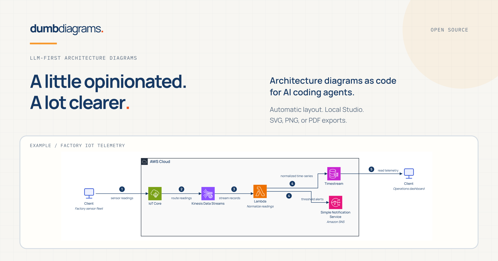
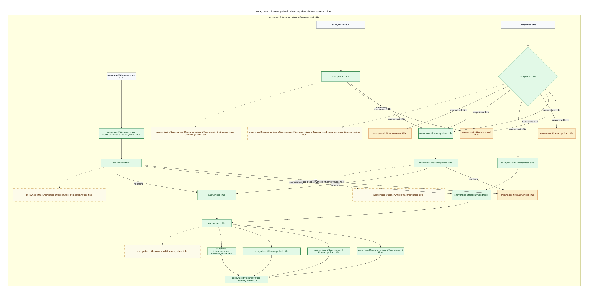
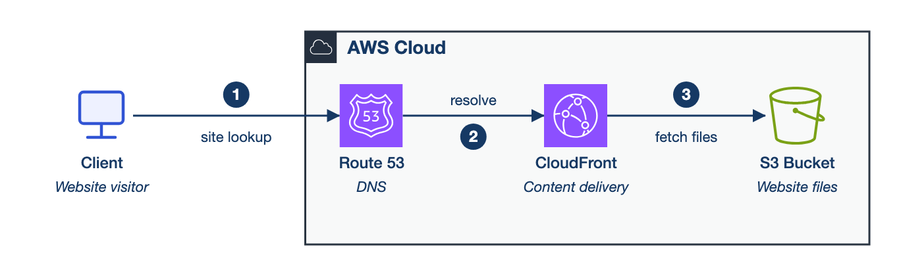
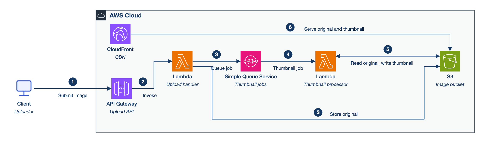
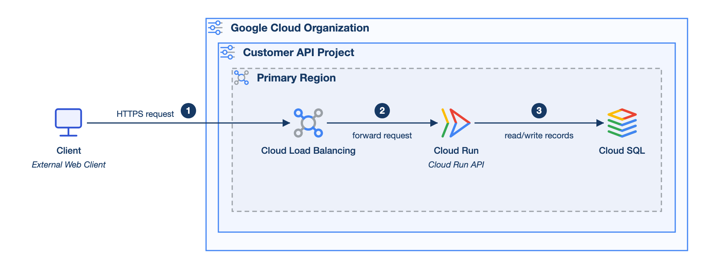
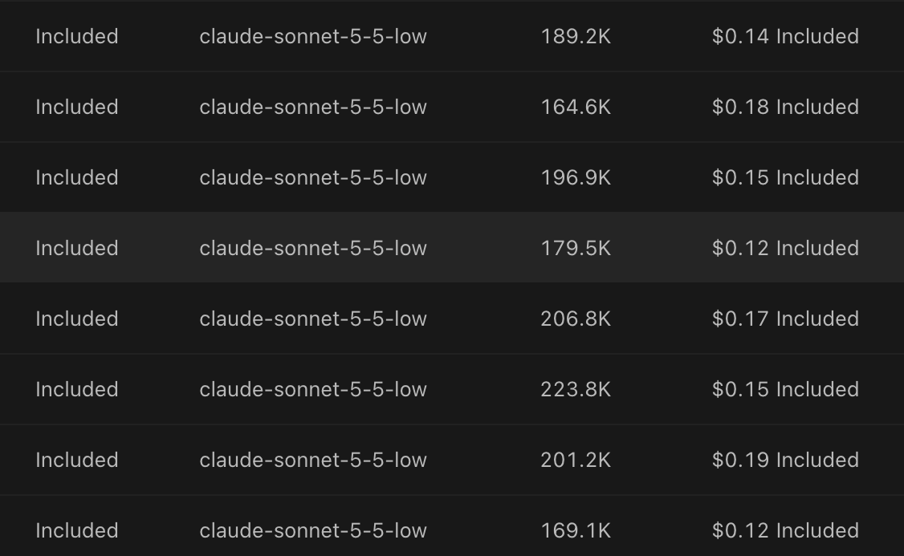

# I wanted an architecture diagram. I got a second job moving boxes.



I know how it looks. Another week, another tool with "AI" somewhere in the pitch. You can barely open a kitchen cupboard right now without some founder tumbling out to explain how their agentic workflow is going to disrupt your teaspoons.

And yes, I still went and built a diagram tool you drive with an LLM. It's called [Dumb Diagrams](https://dumbdiagrams.com), and it's my project - so treat this as the conflict-of-interest disclaimer before I spend the next ten minutes moaning about everyone else's diagramming setup.

Some quick background on me first. I've spent a little over seven years working on backend and cloud systems, which is more than enough time to develop strong, slightly irritable opinions about system diagrams. Along the way I picked up the AWS Solutions Architect Associate cert and, more recently, Claude Solutions Architect Professional. That second one happened mostly because my employer is an Anthropic partner and dangled a cash bonus for passing it. I'm glad I did both, though I won't sit here and pretend my sudden passion for evening study was purely academic. Mainly I mention the day job so you know I didn't pivot into cloud architecture from Solana NFTs last Tuesday.

Anyway. A few months back I was sitting on a mountain of rough architecture notes from meetings that really should have been emails. Hundreds of hours of them. We had an async AWS pipeline, Bedrock in the middle doing its thing, and two or three suspiciously blurry sections where the real answer had clearly been kicked to a future call. I just wanted to turn those notes into a clean diagram I could stick in front of another engineer so we could argue about the design. Proper account boundaries, recognisable AWS icons, and a main request path you can follow without packing supplies.

All the services and arrows were already described in my markdown notes, so hooking an LLM up to a canvas tool over MCP seemed like the obvious lazy shortcut. I fed in the context, asked specifically for official AWS icons, and let it rip.

If you've tried making diagrams this way, you already know how the afternoon went. I'd send a prompt, squint at the canvas, ask it to uncross two arrows, watch it wreck four boxes on the other side of the screen, and wonder why I didn't just draw the whole thing by hand in twenty minutes.

Here is an actual screenshot from one of those runs:



*Real output with the internal names blurred out. Kept around as a reminder of why I started writing a compiler.*

Look at the size of that decision diamond up in the corner. Arrows wander across half the screen past tiny little archipelagos of rectangles, with enough empty yellow wasteland between them to build another AWS region. Zoom in close enough to read the text and you have no idea where the lines go. Zoom out far enough to see the whole diagram and the labels turn into eye-test charts. Also: not a single AWS icon on the page.

A couple of other runs did begrudgingly drop in one lone icon surrounded by twenty plain rectangles, like the only guy who showed up to the office party in fancy dress. By the time I finally closed the tab, I'd burned somewhere around two million tokens across retries, layout fixes, and pure sunk-cost stubbornness. Obviously that's not a scientific benchmark of MCP drawing tools. Half of it was just me refusing to let the computer win.

The truly frustrating part was that I wasn't even talking to the LLM about architecture anymore. Nine prompts out of ten were me acting as a voice-controlled mouse: line these boxes up, add padding, shorten that connector, stop overlapping the text, put the icons back. Worse, every fix played whack-a-mole with the rest of the canvas. MCP gave the model a way to click the drawing tool, sure, but nothing in that setup was actually in charge of layout.

When you ask an agent to drive a general-purpose canvas directly, you're forcing it to do system design and raw pixel arithmetic in the same breath. It's picking cloud services, naming nodes, nesting groups, inventing `(x, y)` coordinates, guessing box widths, looking up icons, and routing polylines inside one context window. Every tiny repair means more tool calls and more coordinate state for the model to hallucinate over. Even if the tool dumps out a whole diagram in one call, the first edit you ask for turns right back into blind geometry guesswork. My token budget was evaporating because "explain how our dead-letter queue works" and "shove that rectangle 40 pixels left" were fighting for the exact same context.

I'm also fussy about how cloud diagrams should look. Personally, I really like the [AWS architecture visual language](https://aws.amazon.com/architecture/icons/). When an AWS diagram is drawn well, you can work out 70% of what the system does before reading a word of text. Boundary boxes show you straight away which account owns what, which region it sits in, and where the VPC walls are. Proper service icons let your brain tell SQS apart from DynamoDB in half a second, instead of making you read twelve identical grey boxes in 8pt font. It's basic visual hygiene, but it saves you from having to ping the author on Slack just to ask which rectangle is the database.

Before writing any layout code, I went looking through [Azure](https://learn.microsoft.com/en-us/azure/well-architected/architect-role/design-diagrams) and [Google Cloud](https://developers.google.com/style/images) docs to see if there was a single cross-cloud visual style I could borrow. Both publish official icon packs and diagramming advice, but their own reference diagrams vary wildly in how they group services, space things out, and route flows. The AWS style was much more consistent, so I treated that as my starting recipe.

From there I built an opinionated layout engine that locks in those rules for boundaries, service icons, labels, and connector routing. I started with AWS and later stretched the same engine across Azure, GCP, and cloud-agnostic diagrams (those other three are in the repo now, though still experimental; AWS is by far the most mature). Baking a strict house style into the tool obviously means giving up freeform control. If you want custom polygons or total freedom over every visual convention, use Excalidraw or draw.io. I wanted a tighter loop: messy architecture notes go in, a structured diagram comes out, and a human nudges the last few details.

Once code handles the geometry, the LLM has a vastly simpler job. It reads your notes, figures out the components, boundaries, and step-by-step flow, and writes them into a small DSL called `.dgm`:

```dgm
dgm 1
diagram payments {
  grammar aws
  flow lr
  title "Payments platform"

  cloud-agnostic.actor customer "Customer"

  aws.region region "AWS Region" {
    aws.api-gateway api "Payments API"
    aws.aws-lambda handler "Payment handler"
    aws.dynamodb ledger "Payment ledger"
  }

  customer -> api { id request step 1 }
  api -> handler { id invoke step 2 }
  handler -> ledger { id persist step 3 }
}
```

There are no X/Y coordinates anywhere in that file, and because service types like `aws.api-gateway` come from a built-in catalog, the official icon is wired straight to the type itself - not something I have to beg for in a follow-up prompt.

After the `.dgm` file is written, the LLM is out of the picture. A deterministic compiler parses and validates the file, measures label widths and boxes, lays out the nested boundary containers, routes orthogonal connectors, and spits out an SVG. Feed it the same `.dgm` source, catalog, saved view, and engine version, and you get the exact same SVG byte-for-byte. That changes how you debug bad diagrams: when an arrow takes a weird detour, I don't have to lecture a language model about whitespace. I open the routing code, write a test, and fix the bug. (Mind you, deterministic code is also very good at drawing the exact same eyesore every single time, so the repo has geometry checks, routing checks, and frozen example snapshots - plus me actually opening the PNGs to look at them.)

Clean geometry doesn't stop a diagram from lying about your system, though. Say your notes specify an API dropping jobs onto a queue for a worker, and the LLM quietly "simplifies" that into a direct synchronous call from the API to the worker. Every line on the page can be laser-straight while the diagram describes the wrong backend.

To catch missing pieces before you ever look at the SVG, the agent also writes a companion requirements file alongside the diagram. It lists the expected components, connections, counts, and boundary memberships using stable IDs, and the validator cross-checks the `.dgm` file against it. If a queue disappears during a refactor pass, a connector gets dropped, or a service lands in the wrong account boundary, the CLI catches it immediately.

That still leaves one obvious blind spot: if the model misreads your notes on pass one and writes the exact same wrong assumption into both the requirements file and the `.dgm` source, both files will agree with each other and pass validation. You still have to read the generated architecture brief and verify it matches what you meant. Deciding whether an SQS queue belongs between two services is the architect's job; I just want the computer to put the box somewhere sensible once I've made that call.

Small diagrams are the easiest place to see how this feels in practice, mostly because the prompt can stay as short as the system it describes. Here's the exact prompt from one of the checked-in test cases:

> Create a simple AWS static website delivery diagram. Show a website visitor, DNS, a content delivery service, and the bucket that stores the website files.



*One-shot output, zero routing warnings in the saved validation run.*

For a four-box diagram, that is the maximum effort I want to spend prompting. Describe the pieces, get back the right icons, a region boundary, and numbered steps - without having to negotiate bottom margins with a chatbot. Better yet, because the diagram is actually legible, you can spot real modelling shortcuts right away during review. Look at steps 1 and 2: running an arrow from Route 53 into CloudFront flattens DNS lookup and the HTTP request path into a single sequence. Route 53 obviously doesn't proxy HTTP traffic for the user, and a clean layout makes it easy for a human reviewer to spot that shortcut in five seconds and decide whether to split the DNS flow out.

Here's a slightly meatier prompt for an image thumbnail pipeline:

> Create an AWS image thumbnail pipeline. An uploader submits an image through an API; the upload handler stores the original and queues a thumbnail job; a processor creates a thumbnail; a content delivery service serves both original and thumbnail images.



*Another one-shot output from the Claude run, zero routing warnings.*

Because the source is just plain text, I can check whether the queue path and S3 bucket relationships make sense first, tweak a line of `.dgm` if something's off, and commit the diff to git. The same approach works on GCP too - here's a small customer-record API with the client outside the organisation boundary and the backend nested inside org, project, and region containers:



*From the GCP prompt bank (GCP layout rules are still experimental).*

If you want to poke through the raw outputs, the [examples directory](examples/README.md) checks in the prompts, `.dgm` sources, requirements files, and validation reports for two full runs of sixteen cases each. I keep those in git to see what shifted whenever I touch the compiler, and every so often they save me from shipping a broken layout. They also keep me honest about where the auto-router still struggles: the nastier multi-boundary diagrams still log routing warnings, and even one of the medium AWS cases in the featured run has them. (The clean thumbnail pipeline above came from the Claude run; the featured run's version of that exact case threw two warnings.)

While building this I mostly used a standard flat-rate subscription, though I also ran separate API tests with Claude Sonnet, Composer 2.5, and a few other cheap, fast models to see what a diagram actually costs at the meter. Trading a free drawing tool for an expensive API habit didn't appeal to me at all. Thankfully the Sonnet numbers behind the docs examples landed firmly in loose-change territory: eight Claude Sonnet 5.5 (low reasoning) runs came in between $0.12 and $0.19 a pop, averaging around fifteen cents.



*Reported usage from the platform, billed against my subscription's included quota. My raw API tests were run separately.*

Fifteen cents and thirty seconds for a clean draft is a deal I'll take any day for routine diagrams. I don't miss spending twenty minutes arguing with a model over where to park the queue icon. (To do a proper benchmark against other tools, I'd obviously need repeated trials across the exact same task suite rather than my own dev runs, but it gave me a solid cost floor and real pictures to judge.)

Automatic layout still hits a ceiling once a diagram gets messy enough. Pile enough nested boundaries, feedback loops, long service names, and crossing paths into a single file and the router will eventually draw something awkward. Half the time, that's a sign the diagram itself is trying to explain too much at once and wants splitting into two or three views. The other half of the time, the scope is fine and one stubborn box just needs dragging twenty pixels to the right.

For that second case, I built Dumb Diagrams Studio, a local web editor where you can open the generated `.dgm` file, drag nodes around or bend connector routes by hand, and hit save. Studio writes those manual tweaks straight back into the same `.dgm` file as view overrides keyed to stable resource IDs. Add another Lambda in text ten minutes later and your manual adjustments stay attached instead of getting blown away. My goal is getting roughly 80% of the way there automatically in under a minute, then using human eyeballs for the last 20%. Small diagrams rarely need touching; dense ones still take real work, just without the miserable blank-canvas phase at the start.

Dumb Diagrams doesn't bundle an LLM or route your prompts through a hosted backend. Everything runs locally on your machine, and you bring whatever coding agent you already use - or skip the agent and write `.dgm` files by hand. A human still has to own the architecture and keep the diagram honest as the system evolves, and I wouldn't want to automate that part away anyway. I want to spend my time checking account boundaries and failure paths, not burning half an hour telling a chatbot that two arrows are overlapping.

Building an entire diagram compiler just to avoid dragging boxes around is probably a classic engineer overreaction, and I'm completely fine with that. Most architects already have the notes, ADRs, and rough explanations for how their system fits together sitting in text files. Turning that material into something you can stick in front of a teammate shouldn't feel like a second job. I'd much rather spend design reviews arguing about whether our retry policy is going to take down prod, whether the account boundary is right, or what is actually supposed to happen inside that suspiciously magical Bedrock box.

*Built for coding agents and humans who've dragged enough boxes for one lifetime.*
