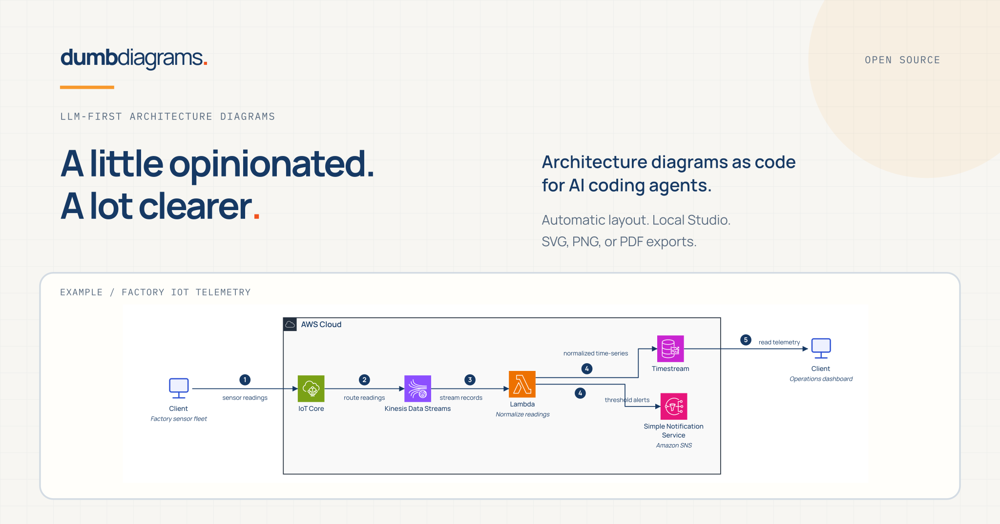
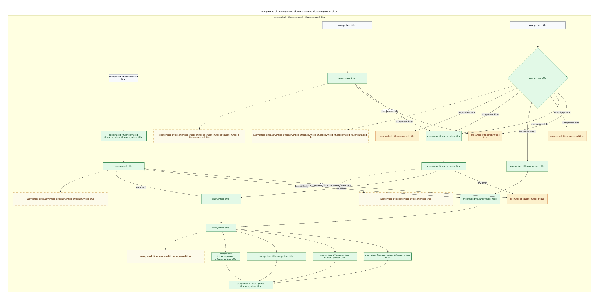
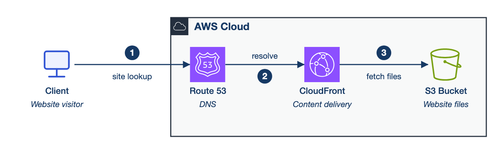
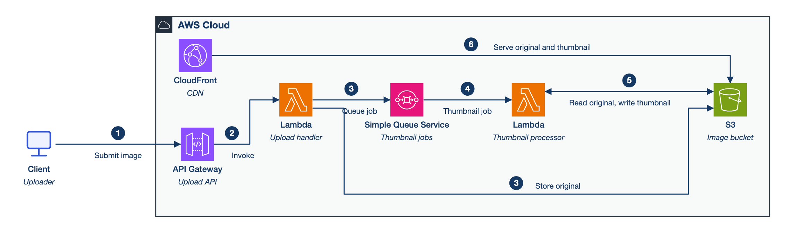
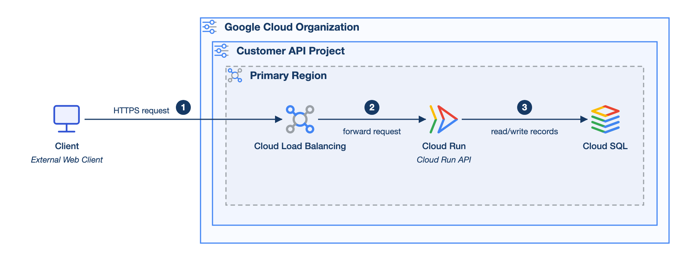
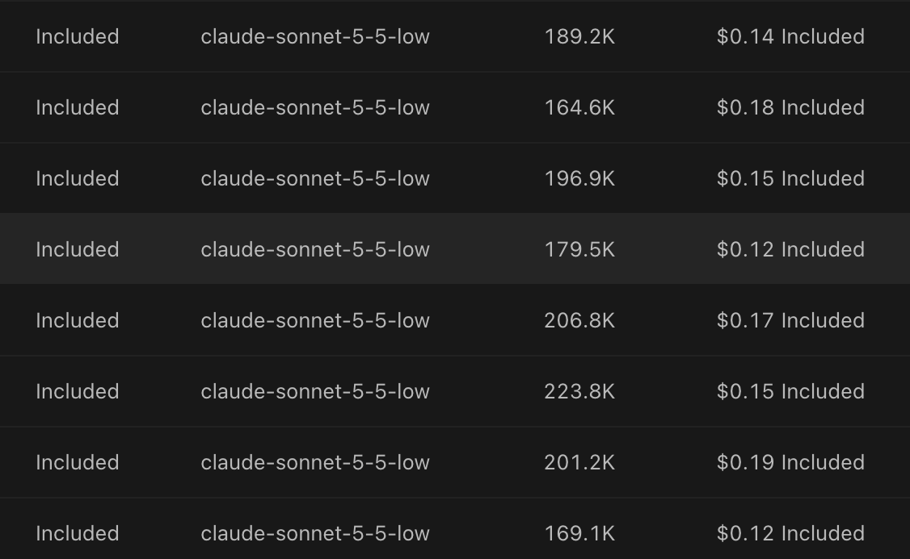

# How I ended up writing a diagram compiler instead of drawing a diagram



Yes, I know. Another tool with AI in the description. These days you can't open a kitchen cupboard without a founder falling out of it to explain what agents are going to do for your teaspoons.

I built one anyway. It's called [Dumb Diagrams](https://dumbdiagrams.com), I made it, and it works with whatever LLM you already use. Consider that the disclosure. Now I can complain about everybody else's tools with a clear conscience.

Quick bit of background so you know where the opinions come from. I've been working mostly on backend and cloud systems for a little over seven years. Along the way I picked up the AWS Certified Solutions Architect Associate and, more recently, Claude Solutions Architect Professional. I'd like to tell you the second one was pure curiosity. My employer has an Anthropic partnership, though, and there was a cash bonus, and I'm only human. I'm glad I've got both. Mostly I bring them up so you can tell me apart from a crypto bro who found out what a VPC was last Tuesday.

Right. The problem.

It started with notes. Hundreds of hours' worth, taken in meetings that could mostly have been emails. They described an asynchronous flow on AWS, Bedrock doing its thing somewhere in the middle, and a couple of patches where the explanation had apparently been saved for a future meeting. I wanted to turn all of it into a diagram I could put in front of another engineer and talk through: account boundaries where they belong, services you'd recognise, and a main path you could trace with a finger.

The notes already had most of what the diagram needed, so handing them to an LLM with a drawing tool attached over MCP seemed reasonable. I gave it the context, asked for AWS icons in so many words, and went through the usual drawing tools. If you've done this, you know the loop. Prompt. Look. Correct. Look again. Somewhere around the fifth go you start wondering if you'd be done by now doing it yourself. This is the sort of thing I ended up with:



*Real output, text anonymised. I've kept it as a reminder of what I was trying to escape.*

That decision diamond in the corner is big enough to want its own postcode. Arrows wander off across half the canvas, passing little islands of boxes with enough empty space around them to provision another region. If you zoom in far enough to read the labels, you can't follow the flow any more, and if you zoom out far enough to see the flow, there's nothing left you can read. The AWS icons I'd asked for never showed up.

Other attempts did a bit better, if you count one lonely icon in a sea of rectangles as better. All told, I'd guess I burned through a couple of million tokens, and that includes the retries and a good amount of plain stubbornness. It isn't a fair test of any particular tool. It's just what it cost me to get one diagram finished while refusing to admit defeat.

What really got to me was how little of it was about the architecture. Line these up. More space there. Shorter route. Bigger label. And could I please have the icons I asked for at the start. Every fix seemed to break something on the other side of the canvas. At some point I realised I'd become the operator of a very enthusiastic remote mouse. MCP had given the model a drawing tool, but nothing was actually in charge of the drawing.

Think about what the agent is holding when it drives a general-purpose canvas. It's picking services and labels, deciding on groups, inventing coordinates and sizes, finding icons and routing every connection, all in the same conversation. Depending on the integration, each repair means more tool calls and more state for the model to keep straight. Even tools that can produce a whole diagram in one call don't really get around this, because the next change you ask for turns back into guessing at geometry. That's where my tokens were going. Explaining how the system works and moving a rectangle 40 pixels to the left were coming out of the same budget.

I'll admit I'm fussy about what the result should look like. I like the [AWS architecture visual language](https://aws.amazon.com/architecture/icons/) a lot: recognisable icons, proper groups and boundaries, and a flow that gives your eyes somewhere sensible to go. When someone uses it well, you can work out a surprising amount before you've read a single label.

A useful boundary tells you which account owns a resource, which region it's in, or where the network edge sits. An icon lets you tell a queue from a database at a glance, instead of reading twelve identical boxes in shrinking text. None of this is sophisticated. Added up, though, it's the gap between a diagram you can understand on your own and one where you end up messaging whoever drew it.

I did look at Azure and GCP as well. [Azure](https://learn.microsoft.com/en-us/azure/well-architected/architect-role/design-diagrams) and [Google](https://developers.google.com/style/images) both publish guidance, and both have official icon libraries, so it's not that nobody's thought about it. But the examples I went through handled grouping, spacing and flow differently enough that I couldn't pull one consistent recipe out of them. The AWS approach clicked much faster, and it was something I actually wanted to copy.

So I went with my own taste and built an opinionated engine, one that makes the same calls about boundaries, icons, labels and connections every time. I started with AWS, planning to carry the approach over to Azure, GCP and cloud-agnostic diagrams later. Those exist now. They're experimental, and AWS is still well ahead of them. Picking a house style means accepting its constraints, and that suited the narrow job I had in mind: architecture notes go in, a useful view of the architecture comes out, and a human tidies up the rest. If you want complete freedom over every shape and convention, you'll be happier in a general-purpose editor.

With those constraints in place, the model's job gets much smaller. It reads the notes, works out what the components are, how they connect, which boundaries they sit in and what the main flow is, then writes that down in a format the engine understands. Measuring, placing, routing and rendering are left to ordinary code. The format is called `.dgm`, and a small file looks like this:

```dgm
dgm 1
diagram payments {
  grammar aws
  flow lr
  title "Payments platform"

  cloud-agnostic.actor customer "Customer"

  aws.region region "AWS Region" {
    aws.api-gateway api "Payments API"
    aws.aws-lambda handler "Payment handler"
    aws.dynamodb ledger "Payment ledger"
  }

  customer -> api { id request step 1 }
  api -> handler { id invoke step 2 }
  handler -> ledger { id persist step 3 }
}
```

You can read the system straight out of that file, and there isn't a coordinate anywhere. Provider types come from a catalog, so the icon comes with the service type. No more asking for it again three prompts later. The compiler takes over from there. It parses and validates the source, measures labels and resources, lays out the nested groups, routes the connections at right angles, and produces an SVG.

Same source, same catalog, same saved view, same engine version: the geometry and SVG should come out the same. That means I can test it, and I can fix it. When a route keeps coming out badly, I go and read the routing code instead of asking a model to feel more strongly about whitespace. Code can be ugly in a perfectly repeatable way too, obviously. So the project has geometry checks, routing checks and frozen examples, and I still open the pictures and look at them.

None of that stops a tidy picture from describing the wrong system. Say the notes have an API putting a job on a queue for a worker, and the model quietly replaces that with the API calling the worker directly. Every line can be dead straight and the diagram is still wrong about how the thing behaves. To catch missing pieces, the agent also writes a requirements file next to the diagram, listing the components, connections, counts and boundaries it should contain. Validation checks the source against that file by stable ID, so dragging a service somewhere else doesn't change what gets checked.

That's good for catching a queue that vanished during a cleanup, a dropped connection, or a service that wandered into the wrong group. It won't help if the model misread the notes in the first place and wrote the same misreading into both files, because then they agree with each other beautifully. You still have to read the requirements and the architecture brief and check they say what you meant. Whether the queue belongs there is the architect's decision. I'd just like the computer to put it somewhere reasonable once I've made it.

The small examples are the satisfying ones, because the prompt can be as simple as the system. Here's the entire prompt from one of the checked-in runs:

> Create a simple AWS static website delivery diagram. Show a website visitor, DNS, a content delivery service, and the bucket that stores the website files.



*One shot, and no routing warnings in the saved validation result.*

For a diagram that size, that's about as much prompting as I want to do. I describe the system and get back the icons, a boundary and a flow, and at no point do I have to negotiate with the bucket about the bottom margin. In a more detailed view I'd pull DNS resolution apart from the HTTP request path, since the arrow from DNS to CloudFront squashes the real sequence a bit. Route 53 isn't passing the visitor's HTTP traffic along. Because the layout is easy to read, though, a reviewer is likely to catch that.

Something a bit busier, an image pipeline:

> Create an AWS image thumbnail pipeline. An uploader submits an image through an API; the upload handler stores the original and queues a thumbnail job; a processor creates a thumbnail; a content delivery service serves both original and thumbnail images.



*Also one shot, from the Claude run, also saved with no routing warnings.*

Here I mostly care about whether the processing path and the storage relationships make sense, before spending any time on presentation. If they don't, I change the text, look again, and commit it. It works the same way for a small GCP API, with the client outside the organisation and the services grouped inside a project and region:



*From the GCP prompt bank. GCP support is still experimental.*

The [examples directory](examples/README.md) has the prompts, sources, requirements and validation results for two runs of sixteen cases each. I use them to see what changed when I break something (and now and then I even notice before it ships). They also stop me overselling it. The more complex cases have routing warnings, and so does one of the medium AWS examples in the featured run. The thumbnail diagram above is from the Claude run; the same case in the featured run has two warnings.

Most of this was done on a subscription plan. I also ran separate API tests with Sonnet, Composer 2.5 and a few other cheap, fast models to get a rough sense of cost, because I didn't fancy discovering a new expensive hobby. The Sonnet runs behind the documentation examples were encouraging. The screenshot below shows eight entries for Sonnet on low reasoning, each between $0.12 and $0.19, so roughly fifteen cents on average.



*Costs as reported by the platform, covered by my subscription's included usage. The API tests were separate.*

In practice, then, I was getting a decent-looking starting point in very little time, for a few cents. For routine diagrams I'll take that every time. I'd also stopped holding a planning meeting with a chatbot about where the queue should go. The engine deals with placement, icons and routing, and the model gets the smaller job of reading the architecture and writing the source. To be clear, this is a rough cost and a handful of pictures. Comparing it fairly with other tools would need repeated runs of the same tasks.

Complex diagrams are where automatic layout starts to show its limits, particularly once boundaries, feedback loops, long labels and competing paths pile up. Sometimes the fix is moving a few things by hand. Other times the architecture needs several views, because one picture is being asked to explain far too much. For the hand-moving part I built a local editor, Dumb Diagrams Studio. You open the generated file, move resources, adjust routes, and those decisions get saved back into the same `.dgm` source as view overrides.

Stable IDs keep compatible adjustments attached when the architecture changes, so the picture you've tweaked stays tied to the source you actually maintain. What I'm after is getting roughly 80% of the way quickly and using my own judgement for the rest. Some small diagrams barely need touching. A dense one can still take proper effort, but that effort is a lot easier to justify when you're starting from something decent.

There's no model built into Dumb Diagrams. You use the coding agent you already have, or write the source yourself, and the layout runs locally. Somebody still has to keep the diagram in step with the real system, and I'm happy for that somebody to be me. Reviewing boundaries, failure paths and assumptions is worth my time. Finding out two arrows overlap, then spending another conversation asking them to stop, really isn't.

Building a diagram engine to avoid drawing a diagram is arguably not a great use of my time. I've thought about that and decided to keep going. Solution architects already have the notes, the decisions and the explanations of how their systems fit together. The path from that to something you can review with a colleague should be short. And when I'm in that review, I'd like to be arguing about whether the retry policy is going to bury us, whether the account boundary is right, or what actually happens inside the magical Bedrock-shaped bit.

*For coding agents, and for anyone who's dragged enough boxes around for one lifetime.*
