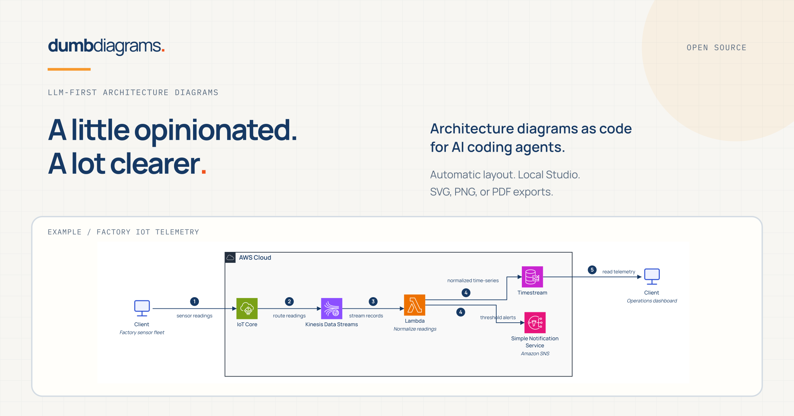
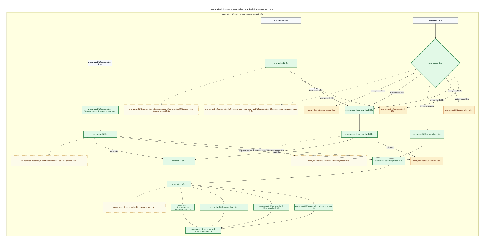
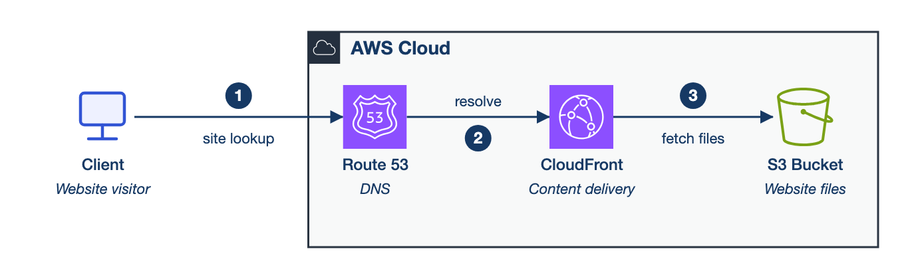
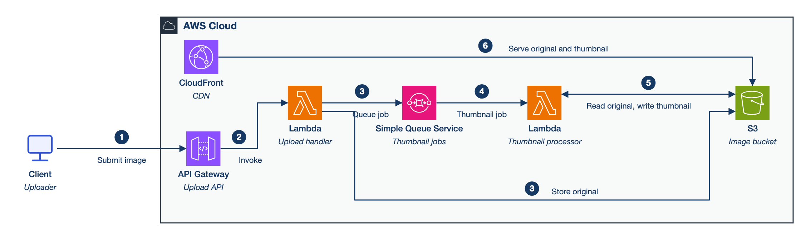
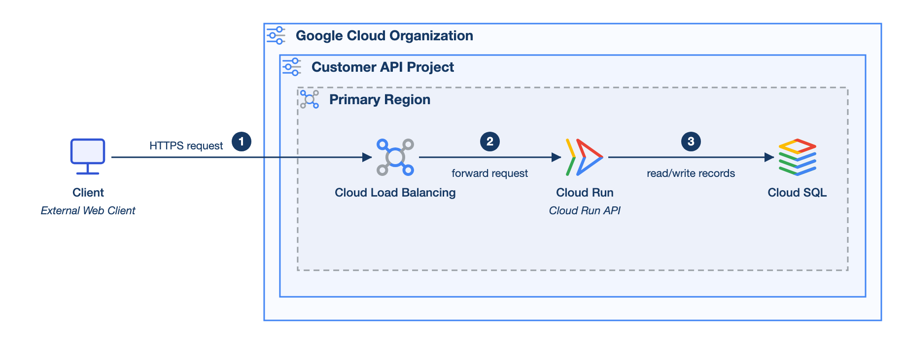
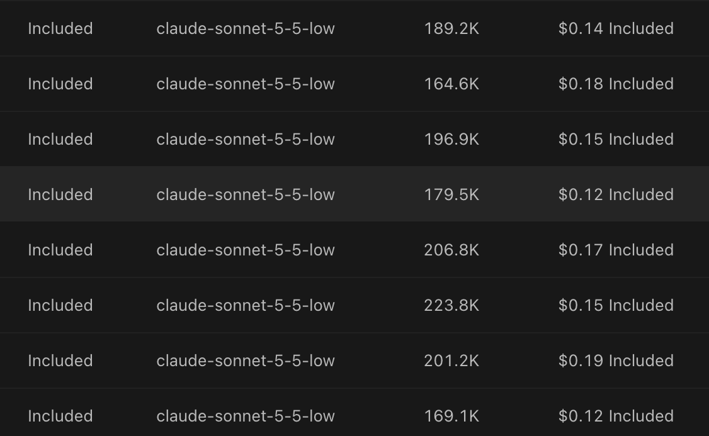

# Two million tokens for one bad diagram



The diagram was supposed to be the easy part. Over a lot of meetings (hundreds of hours, and a good share of them could have been an email) I'd built up a fairly complete written description of an asynchronous system on AWS with Bedrock in the middle. A few parts were still vague, because the people who understood them had promised to explain next time. What I wanted from it was easy to describe: a picture I could put in front of another engineer, with account boundaries in the right places, services you can identify at a glance, and one obvious main path through it.

Trying to get that picture made is how I ended up building [Dumb Diagrams](https://dumbdiagrams.com), so I'm not a neutral party in what follows, and most of this post is about it.

Some context on me, since I'm about to have opinions. I've worked mostly on backend and cloud systems for a little over seven years. I'm an AWS Certified Solutions Architect Associate, and more recently I passed Claude Solutions Architect Professional. That second one happened because my employer is an Anthropic partner and offered a cash bonus for passing. I'd like to say curiosity was the main reason. It wasn't the only one.

Drawing the diagram by hand felt like transcription, since the notes already said what talked to what. So I gave them to a model with a general-purpose drawing tool attached through MCP, asked for AWS icons, and expected it to take a few minutes.

It didn't. After a lot of back and forth and, by my estimate, a couple of million tokens, this is the sort of thing I had:



*Real output from an LLM driving a general-purpose drawing tool over MCP, before Dumb Diagrams existed. I've anonymised the text and left the layout alone.*

The token count covers several attempts at the same diagram, retries included, so it isn't a benchmark of anything. But look at it. A decision diamond takes over one corner. Connections set off on long trips around the canvas. The boxes sit in small clusters separated by acres of pale yellow, and the labels are so small that reading them means zooming in until you can't see where any of the arrows go. I asked for AWS icons, specifically and more than once, and got none. A later attempt managed exactly one, surrounded by plain rectangles.

It was a while before I understood what was going on. Very little of the conversation was about the system. I was asking for boxes to be aligned, gaps to be closed, a connector to be shortened, a label to be made readable, the icons to come back. Each fix tended to break something elsewhere, so I'd ask again. Without really noticing, I had become the layout engine, except that I worked through a chat window and paid per token for every nudge.

MCP did what it promises: it gave the model hands. What it didn't give anyone was responsibility for the layout, so that fell to whoever was most annoyed, which was me.

Thinking about what the model is being asked to do, this isn't surprising. Through a general-purpose canvas it has to choose the services, name them, decide how they group, invent coordinates and sizes for every shape, find each icon and route each connection, all within one context. Depending on the integration, every small repair costs more tool calls and leaves more state to keep track of. Tools that generate a whole diagram in a single call help with the first draft, but the first edit you ask for puts you straight back into guessing at geometry. Explaining how the system works and moving a rectangle 40 pixels to the left end up competing for the same attention and the same budget.

The fix I landed on was to stop asking the model to do the second job at all. Reading a pile of notes and working out the components, how they connect, which boundary each one sits in and what the main flow is: that's language work, and models are good at it. Deciding where a box goes so the lines don't tangle is a different kind of problem. Ordinary code does it better, more cheaply, and the same way every time. The two only need to meet at a text file.

Before writing that code I had to decide what the output should look like, and here I'm biased. I like how AWS architecture diagrams look when they're done well, using the [AWS architecture icons and conventions](https://aws.amazon.com/architecture/icons/). Nested boundaries tell you which account owns something, which region it lives in and where the network edge is. Service icons mean a queue and a database don't look identical. The flow gives your eye somewhere to start. You can learn a lot about a system from one of these before reading a single label.

I looked at [Azure](https://learn.microsoft.com/en-us/azure/well-architected/architect-role/design-diagrams) and [Google Cloud](https://developers.google.com/style/images) as well. Both publish diagramming guidance and official icon sets. The examples I went through varied a lot in how they handled grouping, spacing and flow, though, and I couldn't pull one consistent recipe out of them the way I could with AWS. So AWS became the reference style. The engine supports Azure, GCP and cloud-agnostic diagrams too, but those are experimental, and AWS is clearly the most mature.

Choosing one style on purpose makes the engine opinionated. It makes the same calls about boundaries, icons, labels and connectors every time, and mostly you don't get to argue. That's a real trade-off. If you want control over every shape, a general-purpose editor is the better tool. I wanted something narrower: notes in, a useful view of the architecture out, and a bit of adjustment from a human afterwards.

The text file is a small format called `.dgm`. Here's a complete one:

```dgm
dgm 1
diagram payments {
  grammar aws
  flow lr
  title "Payments platform"

  cloud-agnostic.actor customer "Customer"

  aws.region region "AWS Region" {
    aws.api-gateway api "Payments API"
    aws.aws-lambda handler "Payment handler"
    aws.dynamodb ledger "Payment ledger"
  }

  customer -> api { id request step 1 }
  api -> handler { id invoke step 2 }
  handler -> ledger { id persist step 3 }
}
```

There are no coordinates, sizes or colours in it. Each resource has a type from a catalog, like `aws.api-gateway` or `aws.dynamodb`, and the icon belongs to the type, so I never have to ask for it. `grammar aws` tells the validator which provider's rules to check against. The `step` numbers become the numbered flow you'll see in the examples further down.

After that it's a fairly ordinary compiler pipeline. Parse the source, validate it against the catalog, measure the labels and cards, lay out the nested groups from the inside out, route the connections at right angles, and render SVG.

The property I care about most is that the same source, catalog, saved view and engine version produce the same geometry and the same SVG. It sounds dull, but it changes how I fix things. When a route comes out badly, the problem is in the router, and it'll come out badly again tomorrow, which means I can write a test for it. With a model drawing the picture, the equivalent fix was asking nicely and hoping.

Being deterministic doesn't make anything pretty, of course. A deterministic engine will draw the same ugly route forever if you let it. So the repository has geometry checks, routing checks and frozen example outputs, and I still look at the rendered pictures myself before trusting them.

There's one problem none of this touches: a diagram can be tidy and wrong. Suppose the notes say an API puts a job on a queue and a worker picks it up later, and the model, trying to simplify, draws the API calling the worker directly. The lines are straight, the spacing is lovely, and the diagram now describes a synchronous system that doesn't exist.

To catch that kind of thing, the agent writes a second file before it writes the diagram. It's a requirements contract listing the components, connections, counts and boundaries the diagram has to contain, and `dumbdiagrams validate` checks the source against it by stable ID. The contract is written first and doesn't change during layout repairs, so the model can't quietly lose the queue while it's fixing something else. Moving a resource around the canvas doesn't change what gets checked, either.

What the contract can't catch is a misunderstanding at the very start. If the model misreads the notes, it writes the same misreading into both files, and they agree with each other perfectly. The checker verifies the contract, not whether the model understood you. So you still read the requirements, and the architecture brief the agent writes with them. Whether there should be a queue between two services is a design decision, and it stays with whoever owns the design. I just want the computer to put the queue somewhere sensible once that's settled.

Small examples show the idea best, because the prompt can be as short as the system. This is the whole prompt for one of the checked-in examples:

> Create a simple AWS static website delivery diagram. Show a website visitor, DNS, a content delivery service, and the bucket that stores the website files.



*Generated in one attempt. The saved validation result has no routing warnings.*

Four boxes, a boundary, numbered steps, the right icons, and I didn't mention layout once. It also shows something I like about readable output, which is that modelling shortcuts become easy to see. The arrow from Route 53 to CloudFront runs the DNS lookup and the HTTP request together as if they were one sequence. Route 53 doesn't forward the visitor's traffic anywhere. The browser resolves the name and then talks to CloudFront itself. In a more detailed view I'd split those apart. A reviewer can spot that in a few seconds here, which would be a lot harder in the yellow MCP diagram from earlier.

A slightly bigger one:

> Create an AWS image thumbnail pipeline. An uploader submits an image through an API; the upload handler stores the original and queues a thumbnail job; a processor creates a thumbnail; a content delivery service serves both original and thumbnail images.



*Also generated in one attempt, from the Claude run, with no routing warnings.*

The useful question here is whether the processing path and the storage make sense, and I can answer it before spending any time on presentation. If something's wrong, I change a line of text and commit it, and the diff shows exactly what changed in the architecture.

The same approach on GCP, with the client outside the organisation and the services nested inside a project and a region:



*From the GCP prompt bank. GCP support is still experimental.*

I don't want to suggest every result looks like these. The [examples directory](examples/README.md) has the prompts, sources, requirements and validation results for two full runs of sixteen cases each, and the harder cases have routing warnings. So does one of the medium AWS cases in the featured run. The thumbnail pipeline above is from the Claude run, and the featured run's version of that same case has two warnings. I mainly keep these runs so I can see what changed when I break the engine. Now and then they catch it before a release.

Cost was the other thing I wanted to know before committing to this. I did most of the work on a subscription, but I also ran separate API tests with Sonnet, Composer 2.5 and a few other cheap, fast models to get a rough figure. The Sonnet runs behind the documentation examples are below: eight entries on low reasoning, between $0.12 and $0.19 each, about fifteen cents on average.



*Costs as reported by the platform and covered by my subscription's included usage. The API tests were run separately.*

For a routine diagram, a decent first draft for around fifteen cents is a trade I'll happily make. I'd treat the number with some care, though. It's a handful of runs, not a controlled comparison, and saying anything fair about other tools would take repeated runs of the same tasks.

Automatic layout has limits, and complex diagrams find them. Once you have several levels of boundaries, feedback loops, long labels and paths competing for the same space, something eventually comes out awkward. Sometimes that's the engine. Quite often it's the diagram trying to say too much, and the honest fix is two or three views instead of one.

When the scope is fine and a couple of things just need moving, there's Dumb Diagrams Studio, a local browser editor. You open the generated file, drag resources, adjust routes, and Studio saves those choices back into the same `.dgm` file as view overrides tied to stable IDs. If the architecture changes later, overrides that still fit are kept and stale ones are ignored, so your hand edits don't get wiped every time someone adds a Lambda.

I'm aiming for about 80% of the way there quickly, with my own judgement doing the rest. Small diagrams often need nothing. Dense ones can still take real work, but it's work on top of a sensible starting point rather than an empty canvas.

There's no model built into Dumb Diagrams. You bring the coding agent you already use, or write `.dgm` by hand, and the layout and rendering happen on your machine. That leaves the human with the part that should stay human: checking that the diagram matches the real system, that the boundaries are right, that the failure paths are there and the assumptions hold.

I'm aware that writing a diagram compiler to avoid drawing diagrams is a roundabout way to solve the problem. I still think the problem is real. Architects already write down how their systems fit together, in notes and decision records and long messages to each other, and turning that into something you can review with a colleague should be quick. When I sit down for that review, I want to talk about whether the retry policy will hold up, whether the account boundary is in the right place, and what actually happens in the Bedrock part of the flow that nobody has explained yet.

Not about why two arrows are sitting on top of each other.
