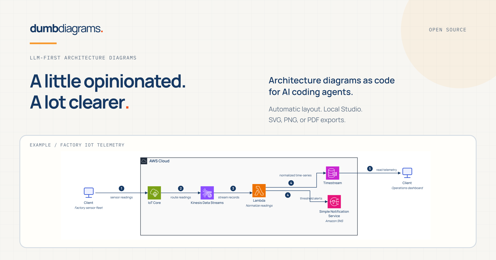
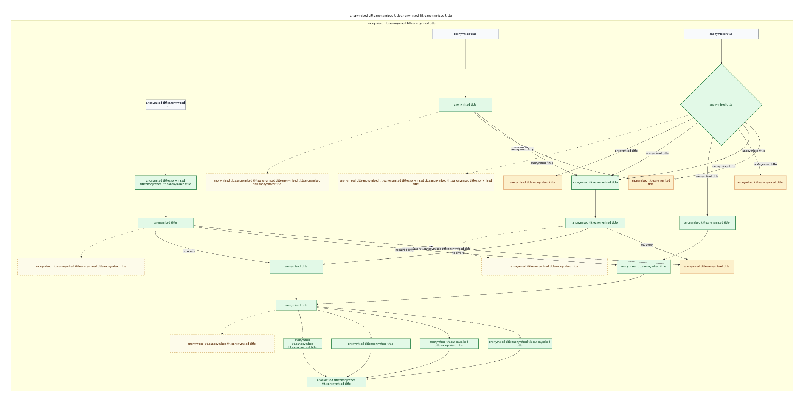
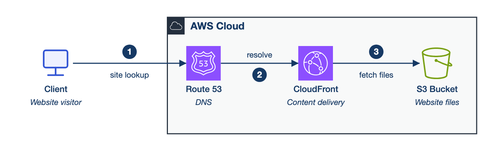
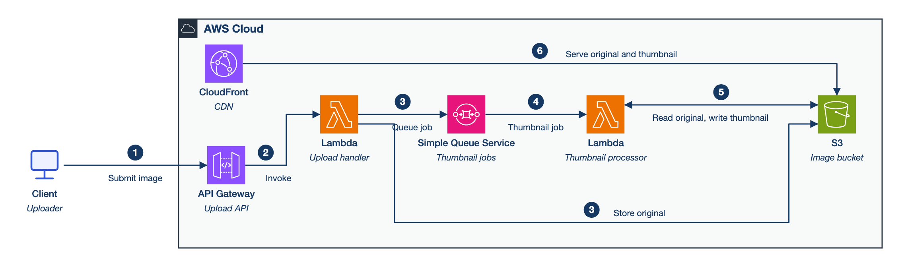
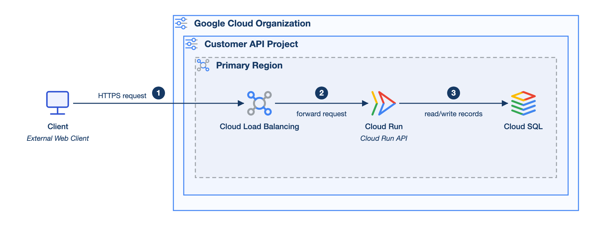
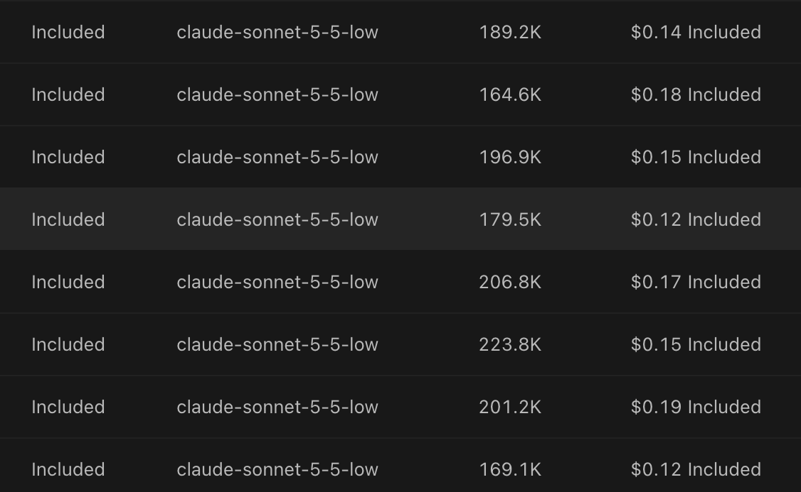

# I wanted an architecture diagram. I got a second job moving boxes.



I know, yet another tool with AI somewhere in the description. You can't even open a cupboard these days without someone falling out of it to explain how their agentic platform will transform your relationship with the teaspoons.

So, naturally, I built something you can use with an LLM. My contribution to the cupboard problem is called [Dumb Diagrams](https://dumbdiagrams.com), and I'm its creator. Consider that the disclosure before I start complaining about everybody else's tools.

I've spent over seven years working mostly on backend and cloud systems, so I came to this with a few opinions already. Along the way I've earned AWS Certified Solutions Architect Associate and Claude Solutions Architect Professional. The latter got a helpful nudge from my employer's Anthropic partnership and the promise of a cash bonus. I'm glad to have both, although I'd be lying if I said my enthusiasm for professional development was entirely unrelated to payroll.

With that out of the way, you now know a little about my background, and I've hopefully done enough to distinguish myself from a random crypto bro who discovered architecture last Tuesday. We can move on to the problem that sent me down this particular rabbit hole.

The project started with a pile of architecture notes gathered over hundreds of hours in meetings that could have been emails. They described an asynchronous AWS flow, Bedrock doing its thing, and a few magical places where the explanation was apparently scheduled for another meeting. I wanted to turn that material into a diagram I could put in front of another engineer and discuss, with clear account boundaries, recognisable services, and a main path you could follow without bringing a packed lunch.

Since the notes already contained most of that information, turning them into a picture seemed like a reasonable job for an LLM with access to a drawing tool through MCP. I supplied the context, explicitly asked for AWS icons, and tried the familiar drawing tools. What followed was the usual cycle of prompting, inspecting, correcting, and wondering whether doing it myself would have been quicker. Here is the sort of result I ended up with:



*Actual output, with the text anonymised. A useful reminder of what I wanted to avoid.*

An enormous decision diamond dominates one corner while arrows take the scenic route across half the canvas, passing little islands of boxes surrounded by enough empty space to provision another region. At a readable zoom level, you lose the overall flow; at a zoom level where the whole thing fits, you lose the will to read it. Meanwhile, the AWS icons I asked for are enjoying a well-earned day off.

Other attempts occasionally produced a single, lonely icon, lost in an ocean of rectangles. Apparently the rest of the architecture had declined the invitation. Across those attempts, I burned what I'd estimate at a couple of million tokens, including all the retries and my own stubbornness. That isn't a controlled comparison of diagramming tools, just the cost of me trying to finish a diagram and refusing to admit defeat.

The maddening part was how little of the remaining work concerned the architecture. I was asking for alignment, spacing, shorter routes, readable labels, and the icons I'd already requested, only to find that a correction would improve one area and make another worse. Eventually, I was managing a very enthusiastic remote mouse. MCP had successfully given the model access to a drawing tool, but I still needed something to take responsibility for the drawing.

An agent controlling a general-purpose canvas can end up juggling service selection, labels, groups, coordinates, dimensions, icons, and individual connections in the same conversation. Depending on the integration, each repair can mean more tool calls and more state for the model to keep straight. Even when an entire diagram is generated in one call, the next request can become another round of visual guesswork. This is where my tokens were going: explaining the system and moving a rectangle 40 pixels to the left were competing for the same budget.

I already had opinions about the output, too. I like the [AWS architecture visual language](https://aws.amazon.com/architecture/icons/): recognisable icons, groups and boundaries, and a flow that gives your eyes somewhere sensible to go. When it is used well, you can work out a surprising amount before reading every label.

A useful boundary tells you which account owns a resource, which region it belongs to, or where a network boundary sits. Recognisable icons let you distinguish a queue from a database without reading twelve identical boxes labelled with increasingly tiny text. These are small visual choices, but together they make the difference between understanding a diagram and having to interrogate its author.

When I looked across Azure and GCP examples, I found it harder to extract one consistent visual recipe I wanted to reproduce. Both [Azure](https://learn.microsoft.com/en-us/azure/well-architected/architect-role/design-diagrams) and [Google](https://developers.google.com/style/images) publish guidance and have official icon libraries, but the examples I looked at varied in their treatment of grouping, spacing, and flow. AWS's approach clicked for me much more immediately and gave me a starting point I actually wanted to use.

So I decided to trust my own taste and build an opinionated engine that would make consistent choices about boundaries, service icons, labels, and connections. The plan was to start with AWS, then carry that approach over to Azure, GCP, and cloud-agnostic diagrams. Those options exist today, though they're still experimental, with AWS remaining the most mature one. Accepting a house style meant accepting constraints, which suited the narrower job I had in mind: architecture notes in, a useful architecture view out, then a small amount of human adjustment. If you want complete freedom over every shape and visual convention, a general-purpose editor is probably a better fit.

Within those constraints, the model's task becomes much smaller. It reads the notes, identifies the components, relationships, boundaries, and main flow, then writes them down in a format the engine understands. Ordinary code can take care of measuring things, placing them, routing the connections, and rendering the result. In Dumb Diagrams, that format is called `.dgm`, and a small source file looks like this:

```dgm
dgm 1
diagram payments {
  grammar aws
  flow lr
  title "Payments platform"

  cloud-agnostic.actor customer "Customer"

  aws.region region "AWS Region" {
    aws.api-gateway api "Payments API"
    aws.aws-lambda handler "Payment handler"
    aws.dynamodb ledger "Payment ledger"
  }

  customer -> api { id request step 1 }
  api -> handler { id invoke step 2 }
  handler -> ledger { id persist step 3 }
}
```

You can read the system in that file without negotiating canvas coordinates. The provider types come from a catalog, so each icon is attached to its service type instead of being something I have to beg for in the next prompt. From there, the compiler parses and validates the source, measures labels and resources, lays out the nested groups, routes right-angle connections, and produces SVG.

With the same source, catalog, saved view, and engine version, the geometry and SVG should repeat, which gives me something I can test and fix. If a route is consistently bad, I can investigate the routing code without asking a model to feel more strongly about whitespace. Deterministic output can, of course, be deterministically ugly, so the project has geometry checks, frozen examples, and routing checks, and I still look at the pictures. Repeating a mistake with excellent consistency is still a mistake.

Even a nice picture can describe the wrong system. Suppose the notes say that an API queues a job for a worker, and the model quietly replaces that with a direct API-to-worker call. Every line could be perfectly straight while the diagram communicates the wrong behaviour. To catch missing pieces, the agent also writes a companion requirements file listing the components, connections, counts, and boundaries the diagram needs. Validation checks the source against that file using stable IDs, so moving a service around doesn't change what gets checked.

This helps catch a queue disappearing during a cleanup, a connection being dropped, or something ending up in the wrong group. If the model misunderstands the notes and writes that misunderstanding into both files, though, they can agree beautifully. You still need to read the requirements and the architecture brief and check that they describe what you actually meant. An architect has to decide whether the queue belongs there; I would just like the computer to put it somewhere reasonable once that decision is made.

The small examples are where this becomes satisfying, because the request can stay as simple as the system it describes. Here is the complete prompt from one of the checked-in runs:

> Create a simple AWS static website delivery diagram. Show a website visitor, DNS, a content delivery service, and the bucket that stores the website files.



*Generated in one shot, with no routing warnings in the saved validation result.*

This is about the amount of prompting I want to do for a diagram that simple: describe the system and get back the service icons, a boundary, and a flow, without having to specify the bucket's emotional relationship with the bottom margin. I'd still separate DNS resolution from the HTTP request path in a more detailed view, since that arrow from DNS to CloudFront compresses the logical sequence. Route 53 isn't forwarding the visitor's HTTP traffic, and a readable layout makes it easier for a human to spot that distinction during review.

A slightly busier example asks for an image pipeline:

> Create an AWS image thumbnail pipeline. An uploader submits an image through an API; the upload handler stores the original and queues a thumbnail job; a processor creates a thumbnail; a content delivery service serves both original and thumbnail images.



*A one-shot example from the Claude run, also saved with no routing warnings.*

The useful part here is being able to review whether the processing path and storage relationships make sense before spending time on presentation. I can change the architecture in text, see the effect, and keep the change in version control. The same approach carries over to a small GCP API, with the client outside the organisation and the services grouped inside a project and region:



*An example from the GCP prompt bank. GCP support is still experimental.*

The [examples directory](examples/README.md) has the prompts, source, requirements, and validation results for two runs of sixteen cases each, so I can check what changed when I break something. Occasionally I even catch it before shipping. Those examples also keep me honest: the more complex cases have routing warnings, and even one of the medium AWS examples in the featured run has them. The thumbnail diagram above comes from the Claude run, while the same case in the featured run has two warnings.

Most of the time, I was using a subscription plan, although I also ran separate API tests with Sonnet, Composer 2.5, and other cheap, fast models to get a rough idea of the costs. Before developing another expensive hobby, I wanted to know whether generating a useful diagram was spare-change territory. The Sonnet runs behind the documentation examples were encouraging: the screenshot below shows eight Sonnet low entries between $0.12 and $0.19, averaging roughly fifteen cents per entry.



*The platform's reported costs, covered by my subscription's included usage. The API tests were separate.*

In practice, I was getting a good-looking starting point quickly, with usage costs measured in cents, which is a trade I'll happily take for routine diagrams. I had finally stopped holding a planning meeting about where to put the queue. The engine handles placement, icons, and routing, leaving the model a smaller job: read the architecture and write the source. These runs give me a rough cost and some actual pictures to judge, although I'd need repeated tests on the same tasks to make a fair comparison with other tools.

Complex diagrams still expose the limits of automatic layout, especially as boundaries, feedback loops, long labels, and competing paths pile up. Sometimes the right fix is a manual adjustment, and sometimes the architecture needs several views because one picture is being asked to explain far too much. That is why I built a local editor, Dumb Diagrams Studio, where I can open the generated file, move resources, adjust routes, and save those decisions into the same `.dgm` source as view overrides.

Stable IDs keep compatible adjustments attached when the architecture changes, so the edited picture stays connected to the source I maintain. My target is getting roughly 80% of the way there quickly, then using my own judgment for the rest. Some small diagrams need very little attention, while a dense diagram can still require proper effort. Having a decent starting point makes that effort much easier to justify.

There is no model built into Dumb Diagrams, so you can use your existing coding agent or write the source yourself, with the layout running locally. Somebody still has to keep the diagram aligned with the real system, and I'm quite happy for that somebody to be me. Reviewing boundaries, failure paths, and assumptions is useful work. Discovering that two arrows overlap and spending another conversation asking them to stop is considerably less useful work.

Building a diagram engine to avoid drawing a diagram may also qualify as a questionable use of my time, but I have considered this argument and chosen to continue. Solution architects already have notes, decisions, and explanations of how a system fits together, and there should be a short path from that material to something they can review with another person. I want to spend that review discussing whether the retry policy will bury us, whether the account boundary is correct, or what actually happens in the magical Bedrock-shaped bit.

*Built for coding agents and humans who’ve dragged enough boxes for one lifetime.*
