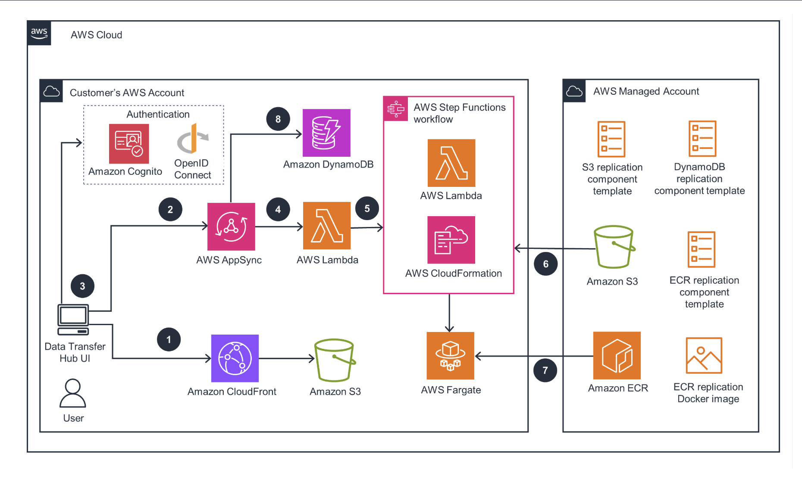

<div align="center">


# Dumb Diagrams

**LLM-first architecture diagrams that are hard to get wrong.**

Deterministic layout, validated `.dgm` source, and a local Studio — built for coding agents and the humans steering them.

<br />

[](https://www.npmjs.com/package/dumbdiagrams)
[](https://nodejs.org/)
[](./LICENSE)
[](https://pnpm.io/)

</div>

---

End users install the [`dumbdiagrams`](https://www.npmjs.com/package/dumbdiagrams) npm package — not this repository. This repo is for developing the editor and publishing the CLI.

**Requires Node.js 24 or newer.**

## Quick start

```bash
npx dumbdiagrams@latest init --open-editor
# Prompts for a project name and opens it in your editor.
# Run the printed `Next:` command to open its diagrams folder in Studio.
```

Each project is a shared workspace for you and your coding agent. Diagrams live as separate `.dgm` files under `diagrams/`; Studio watches the selected file and renders the result.

<p align="center">
  
</p>

## Install options

In an interactive terminal, omitting the directory opens a project-name prompt. The answer becomes the display name and a safe kebab-case folder name:

```bash
# Named folder and starter diagram
npx dumbdiagrams@latest init \
  --name "Payments Platform" \
  --diagram system-overview \
  --description "Event-driven billing architecture."

# Separate output path and display name
npx dumbdiagrams@latest init \
  --directory ./projects/payments \
  --name "Payments Platform"

# Non-interactive timestamped fallback
npx dumbdiagrams@latest init --yes
```

`init` also writes `DUMB_DIAGRAMS.md`, `AGENTS.md`, `CLAUDE.md`, `CATALOG.md`, and `CATALOG.json` — the agent contract for icon types, hierarchy rules, and project conventions. Add `--open-editor` or `--editor cursor` / `--editor code` to open the project during setup.

## Agent workflow

Once the project is open in Cursor, VS Code, Claude Code, Codex, or another agent:

```text
Read DUMB_DIAGRAMS.md, diagrams/README.md, and examples/README.md. Inspect
the closest prompt/source pair in examples/. For a new request, create a new
descriptive file under diagrams/; do not overwrite an existing .dgm unless the
user names it explicitly. Follow the examples' explicit hierarchy, labels,
numbered stages, edge direction hints, and routing constraints. Run
`npx dumbdiagrams@latest validate diagrams` when finished.
```

Agents create or edit ordinary `.dgm` files, run `validate`, and Studio reflects the change. The required contract is local `DUMB_DIAGRAMS.md`; bundled examples are style references, not runtime dependencies.

## Test the tarball locally

This exercises the same package boundary as `npx`, without publishing. From the repository root:

```bash
pnpm install --frozen-lockfile
pnpm build
mkdir -p .artifacts/packages
pnpm --dir packages/cli pack --pack-destination ../../.artifacts/packages

export ARTIFACT="$(pwd)/.artifacts/packages/dumbdiagrams-0.1.0.tgz"
export CLI="npx --yes --package=$ARTIFACT dumbdiagrams"
```

The AGPL package includes its corresponding buildable source under
`dist/source/`, including the vendored catalog inputs needed for a clean build.

### Full smoke test (new project + Studio)

```bash
PROJECT_DIR="../dumb-diagrams-$(date +%Y-%m-%d-%H-%M-%S)"
$CLI init "$PROJECT_DIR" --open-editor --editor cursor
$CLI studio "$PROJECT_DIR/diagrams"
```

`PROJECT_DIR` is a sibling of the repository so the test project stays outside the worktree. Use `--editor code` for VS Code.

### Test individual CLI commands

The full `init` flow creates a whole project. To exercise specific options in isolation, point each command at its own temp directory or at files that already exist:

```bash
TMP="$(mktemp -d)"

# Reference — no project created
$CLI --version
$CLI help

# Init flags, one scenario per folder
$CLI init "$TMP/by-name" --name "Payments Platform" --diagram billing-flow
$CLI init "$TMP/by-yes" --yes
$CLI init "$TMP/with-desc" --name demo --description "Smoke-test project"

# Read-only commands against an initialized project
$CLI validate "$TMP/by-name/diagrams"
$CLI render "$TMP/by-name/diagrams/architecture.dgm" --output "$TMP/out.svg"
$CLI format "$TMP/by-name/diagrams/architecture.dgm"

# Studio without opening a browser (Ctrl+C to stop)
$CLI studio "$TMP/by-name/diagrams" --no-open --port 4799
```

After publishing, swap `$CLI` for `npx dumbdiagrams@latest` (or `@0.1.0` for a pinned version).

### After publishing to npm

```bash
npx dumbdiagrams@latest init --open-editor
npx dumbdiagrams@latest studio diagrams
npx dumbdiagrams@latest validate diagrams

# Optional global install (exposes dumbdiagrams and dgm)
npm install -g dumbdiagrams
dumbdiagrams init --yes
dgm studio diagrams
```

The unscoped `dumbdiagrams` package is public on npm. For a private preview, use a scoped package with restricted access, or keep using the local tarball flow above.

## Develop this repository

```bash
pnpm install --frozen-lockfile
pnpm build
pnpm test

# Render a fixture
node packages/cli/dist/index.js fixtures async-docs

# Open the local Studio against a source file
node packages/cli/dist/index.js studio examples/diagrams/aws-high-availability-web-app.dgm

# Render from source
node packages/cli/dist/index.js render examples/diagrams/aws-high-availability-web-app.dgm --output output.svg

# Validate examples
node packages/cli/dist/index.js validate examples/diagrams

# Create an agent-ready project
node packages/cli/dist/index.js init --name "Local Preview" --open-editor
```

## Packages

| Package | Role |
| --- | --- |
| `dumbdiagrams` | Publishable CLI and local Studio runtime |
| `@dumb-diagrams/runtime` | Model, catalog, `.dgm` parser, layout, routing, and rendering |
| `@dumb-diagrams/editor` | Browser editor (Vite + React) |

## Repository layout

- `assets/catalog/` contains reviewed provider inputs, source locks, and
  collision policy. Its [README](./assets/catalog/README.md) documents the
  generation lifecycle.
- `examples/diagrams/` contains `.dgm` examples; prompt and visual references
  remain in the neighboring example directories.
- `packages/runtime`, `packages/editor`, and `packages/cli` are the only
  workspace packages.
- `scripts/`, `docs/`, and `e2e/` contain root tooling, release documentation,
  and browser tests.
- `.artifacts/` is ignored and contains coverage, Playwright output, rendered
  fixtures, and packed tarballs.

The repository pins pnpm exactly. Installs use isolated linking, strict peer and
engine checks, a 24-hour package release delay, and a dependency lifecycle
allowlist containing only reviewed `esbuild` execution. Run
`pnpm check:dependencies` after changing imports or package manifests; it
rejects undeclared external imports in root tooling and every workspace.

## Editor

```bash
pnpm dev
```

Each `.dgm` file is the portable source of truth for one diagram. `dumbdiagrams studio diagrams` opens the project folder and lets you select a source file; `dumbdiagrams studio diagrams/name.dgm` opens one file directly. Studio writes back to disk, watches edits from Cursor, Codex, Claude, or another editor, and protects saves with revision checks.

v0.1 is desktop-focused: 900px minimum layout width, ~1280px supported baseline. A small-screen responsive editor is out of scope for v0.1.

## Future landing page and docs

Keep plain pnpm workspaces. When you add a marketing site, place a private Astro app in `packages/docs` and deploy it with a separate CI job so docs changes do not force npm packaging or Studio deployment. Nx or Turborepo are optional only if measured CI build time becomes a bottleneck.

## Licensing and publication

Copyright © 2026 DumbDiagrams contributors. Original Dumb Diagrams source,
package code, and repository-authored examples are licensed under the
[GNU Affero General Public License v3.0 only](./LICENSE). Modified versions
offered over a network must make their corresponding source available to their
users. Provider catalog icons remain subject to
[ICON-NOTICES.md](./ICON-NOTICES.md).

Workspace packages version together from a `vMAJOR.MINOR.PATCH` tag. Versioning rules and the release checklist live in [docs/VERSIONING.md](./docs/VERSIONING.md) and [docs/RELEASE.md](./docs/RELEASE.md). See [CHANGELOG.md](./CHANGELOG.md) for release notes.
