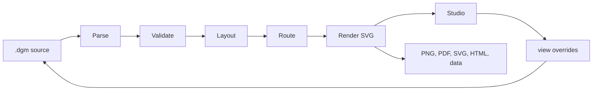

# Architecture

Dumb Diagrams is a source-first diagram compiler with a local browser editor.
The contract that everything else protects: the same valid source, catalog,
and saved view produce the same geometry, routes, and SVG.

## Pipeline

1. **Parse** (`runtime/src/dsl/parse.ts`) reads the versioned format into a
   `DiagramDocument`. It is strict: unknown keywords or values fail with a line
   and column. `printDgm` is the canonical printer, and
   `printDgm(parseDgm(x))` must equal `x` for canonical sources.
2. **Validate** (`runtime/src/core/validate.ts`) checks IDs, catalog types,
   provider grammar, and containment. Provider network rules live in
   `core/provider-rules.ts`, one table per grammar.
3. **Layout** (`runtime/src/layout`) measures cards and labels, places nested
   groups from the inside out, and applies `view` overrides.
4. **Route** (`runtime/src/route/router.ts`) is a Manhattan router: it scores
   candidate ports and gutters, repairs conflicts, and falls back to grid A\*.
   A deterministic work budget bounds it. When the budget runs out, it keeps
   the best routes found so far and reports a `routing-budget` warning.
5. **Render** (`runtime/src/render`) emits SVG. Geometry invariants
   (`render/invariants.ts`) report overlaps and crossings as warnings.

`view` blocks carry positions, sizes, visibility, and pinned routes for stable
IDs. If the architecture changes, compatible overrides are kept and stale ones
are ignored.

## Packages

| Package | Owns |
| --- | --- |
| `packages/runtime` (private, bundled into the CLI) | Model, parser, catalog, validation, layout, routing, rendering |
| `packages/editor` (private) | React Studio: source drawer, canvas, workspace tabs, exports |
| `packages/cli` (`create-dumb-diagrams`) | `init`, `studio`, `validate`, `format`, `render`; project templates; loopback Studio server |
| `packages/brand` | Fonts, colors, wordmark |
| `packages/website` | Astro site and public docs |

The catalog is the source of truth for types, icons, and containment. Inputs
live in `assets/catalog/`. `pnpm catalog:generate` writes the runtime manifest,
and the editor gets a smaller index so its entry chunk stays cacheable.

## Editor

`main.tsx` wires the UI. Domain logic lives elsewhere:

- `editor-model.ts` holds pure document operations, locked by
  `editor-model.golden.test.ts`.
- `model/` covers clipboard, asset import, catalog placement, and grouping.
- `state/` covers the workspace, history, persistence, file save and open, URL
  import, and exports.
- `interactions/` owns pointer gestures and their cleanup.

Compilation runs in a worker. Its messages carry validated plain data, not
Result objects. Studio keeps the last valid preview while the source is
invalid. Save requires valid source, and it checks for on-disk changes before
overwriting.

`router.ts` is one deterministic scoring pipeline. New scoring terms need
focused router tests and must keep tie-breaking stable. Never combine a file
split with routing changes.

## Error handling

Expected failures use neverthrow `Result`/`ResultAsync` with a local error
union. `pnpm check:results` enforces that each one is consumed. Platform
exceptions are adapted at the boundary. Programming defects still throw.

| Package | Modules returning `Result` | Error type |
| --- | --- | --- |
| runtime | `dsl/parse.ts` | `DgmParseError` |
| runtime | `render/sanitize-svg.ts` | `SvgSanitizeError` |
| runtime | `render/compile.ts` | `DiagramValidationError` |
| runtime | `render/assets.ts`, `render/svg.ts` (`renderPortableSvg`) | `PortableSvgError` |
| editor model | `asset-import.ts`, `catalog-placement.ts`, `clipboard.ts`, `document-operations.ts` | one union per module |
| editor state | `clipboard-actions.ts`, `document-actions.ts`, `document-import.ts`, `export-actions.ts`, `workspace-persistence.ts` | one union per module |
| cli | `index.ts`, `init-options.ts` | `CliError` |

Plain domain unions are used instead where cancellation and conflicts are
normal outcomes: `file-save.ts`, `file-open.ts`, the worker compile DTOs, and
`auto-fix.ts`. `parseDgm` is a documented throwing adapter for scripts and
tests; product code uses `parseDgmResult`.

## Security boundaries

- Studio's server binds to `127.0.0.1` and serves static files only, with
  restrictive headers. It has no file or project API.
- Embedded and imported SVGs go through `sanitizeSvgResult`, which allowlists
  elements and attributes and accepts only the standard SVG and XLink
  namespaces. `compileDiagram` rejects unsafe assets, and `renderSvg` omits
  them rather than embedding them.
- The runtime makes no network calls. Portable exports load catalog icons
  through a caller-supplied loader.

Report security issues as described in [SECURITY.md](../SECURITY.md).

## Test layers

| Layer | Where | Protects |
| --- | --- | --- |
| Unit | `packages/*/src/**/*.test.ts` | Parser, validation, router, renderer, editor model and state, CLI |
| Compat corpus | `tests/compat/v1/` | Every format-1 keyword parses, round-trips, and renders to a frozen SVG |
| Canonical sources | `tests/integration/canonical-sources.test.ts` | Every tracked `.dgm` is canonical and valid |
| Curated examples | `tests/integration/examples/` | SVG goldens, layout contracts, exact provider warnings |
| Editor goldens | `packages/editor/src/editor-model.golden.test.ts` | The source each editor operation writes |
| Baselines | `pnpm check:routing`, `pnpm check:performance` | Reviewed routing warnings; routing work counters |
| Browser | `e2e/`, `e2e-packed/` | Studio journeys on Chromium; the packed CLI's Studio |
| Package | `pnpm smoke:package` | The npm tarball, installed into a clean project |

Commands and baseline updates are in [CONTRIBUTING.md](../CONTRIBUTING.md).
