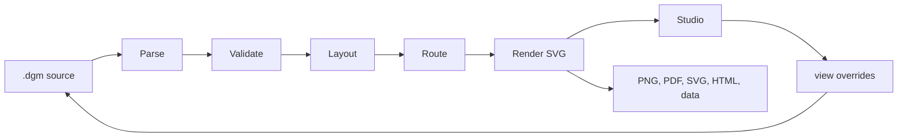

# Architecture

Dumb Diagrams is a source-first diagram compiler with a local browser editor.
The contract that everything else protects: the same valid source, catalog,
and saved view produce the same geometry, routes, and SVG.

## Pipeline

1. **Parse** (`runtime/src/dsl/parse.ts`) reads the versioned format into a
   `DiagramDocument`. It is strict: unknown keywords or values fail with a line
   and column. `printDgm` is the canonical printer, and
   printing a successfully parsed canonical source must reproduce it exactly.
2. **Validate** (`runtime/src/core/validate.ts`) checks IDs, catalog types,
   provider grammar, and containment. Provider network rules live in
   `core/provider-rules.ts`, one table per grammar.
3. **Layout** (`runtime/src/layout`) measures cards and labels, places nested
   groups from the inside out, and applies `view` overrides. Account flow
   ordering reuses computed graph chains and skips cycle back-edges, keeping
   dense and cyclic graphs bounded and deterministic.
4. **Route** (`runtime/src/route/router.ts`) is a Manhattan router: it scores
   candidate ports and gutters, repairs conflicts, and falls back to grid A\*.
   A deterministic work budget bounds it. Dense routing grids are capped at
   one million cells before allocation and are skipped when there are no
   edges. When a work or grid memory limit is reached, routing keeps the best
   available routes and reports a `routing-budget` warning. Oversized canvases
   use template and perimeter routes without the dense A* grid.
5. **Render** (`runtime/src/render`) emits SVG. Geometry invariants
   (`render/invariants.ts`) report overlaps and crossings as warnings.

`view` blocks carry positions, sizes, visibility, and pinned routes for stable
IDs. If the architecture changes, compatible overrides are kept and stale ones
are ignored.

CLI authoring validation also reads a required companion requirements contract.
The pure `runtime/requirements` module checks the parsed component and edge IDs,
counts, and hierarchy without invoking layout. The CLI reports source/provider
validity, contract completeness, and routing separately. Normal validation fails
on validity or completeness; strict validation additionally fails on routing
findings. Studio and the source format remain independent of this companion file.
Contracts record model-extracted intent; checking them does not verify the model's
interpretation of the original prompt.

## Packages

| Package | Owns |
| --- | --- |
| `packages/runtime` (private, bundled into the CLI) | Model, parser, catalog, validation, layout, routing, rendering |
| `packages/editor` (private) | React Studio: source drawer, canvas, workspace tabs, exports |
| `packages/cli` (`create-dumb-diagrams`) | `init`, `studio`, `validate`, `format`, `render`; project templates; loopback Studio server |
| `packages/brand` | Fonts, colors, wordmark |
| `packages/website` | Astro site and public docs |

Cross-package imports use public exports. Runtime has no Node or React
imports; editor model operations cannot depend on UI or state controllers.
`pnpm check:dependencies` enforces these directions. Keep pure model operations,
platform adapters, and React orchestration separate; extract a module when it
owns a coherent responsibility, not to meet a file-size target.

The catalog is the source of truth for types, icons, and containment. Inputs
live in `assets/catalog/`. `pnpm catalog:generate` writes the runtime manifest,
and the editor gets a smaller index so its entry chunk stays cacheable.
The npm CLI bundles Studio and the runtime into one installable artifact;
`smoke:package` tests that artifact in a clean project. A declared source
manifest also ships the corresponding source needed to rebuild it, excluding
local notes and generated output. The website is static Astro with local
Pagefind search; hosting and optional consent-gated analytics are documented in
`packages/website/README.md`. CI runs static/unit/package checks, browser
journeys, and website checks independently; publishing repeats the release gate.

## Editor

`main.tsx` wires the UI. Domain logic lives elsewhere:

- `editor-model.ts` holds pure document operations, locked by
  `editor-model.golden.test.ts`.
- `model/` covers clipboard, asset import, catalog placement, and grouping.
- `state/` covers the workspace, history, persistence, file save and open, URL
  import, and exports.
- `interactions/` owns pointer gestures and their cleanup.

Compilation runs in a worker. Its messages carry validated plain data, not
Result objects. Studio keeps the last valid preview while the source is
invalid. Save requires valid source, and it checks for on-disk changes before
overwriting.

Studio retains the first 200 geometry diagnostics and reports the exact count
of additional findings in one summary. Auto-fix requires complete diagnostics
before comparing candidates. The runtime's default invariant report remains
complete for CLI and quality checks.

Each compiler cache (UI and worker) retains at most 12 results within an 8 MiB
estimated object budget. Oversized results can still be displayed without
being cached. Undo and redo share a 100-snapshot limit and a 4 MiB source-string
budget per tab. Persistence retains one active write and the latest pending
workspace, with a synchronous recovery journal protecting reloads.

`router.ts` is one deterministic scoring pipeline. New scoring terms need
focused router tests and must keep tie-breaking stable. Geometry and quality
ties use explicit string ordering, never ambient locale, randomness, or clocks.
Never combine a file split with routing changes.

## Error handling

Expected failures return neverthrow `Result<T, LocalError>` or
`ResultAsync<T, LocalError>`. Error unions belong to the module that owns the
operation; give each case a stable `code` and a useful `message`. Pure functions
that cannot fail return ordinary values. Do not add a Result wrapper to every
helper or catch an entire compiler pipeline to hide programming defects.

- Compose synchronous steps with `andThen`, `map`, `mapErr`, or `safeTry`.
  Consume the final result with `match` or an explicit `isErr` branch at the UI
  or CLI boundary. Never use unsafe unwraps in production.
- Adapt throwing platform APIs once, at their boundary: `Result.fromThrowable`
  (or a narrow `try/catch`) for synchronous work, `ResultAsync.fromPromise` for
  asynchronous work. Invoke callbacks inside `Promise.resolve().then(...)`
  when they can throw before returning a promise. Custom portable icon loaders
  return `ResultAsync<string, PortableSvgError>`; typed failures propagate
  unchanged. Do not introduce exception-based domain control flow.
- Cancellation, save conflicts, and worker messages use plain tagged data.
  Result class instances cannot cross worker structured-clone boundaries.
  Worker/compiler DTOs and the legacy `compileDiagram` union remain adapters;
  new fallible product code uses `parseDgmResult` and `compileDiagramResult`.
- `parseDgmResult` is the sole parser entrypoint, including scripts and tests.
  Tests may unwrap known-valid fixtures; production code must consume Results.
  Gesture cleanup may rethrow unexpected callback defects after releasing
  resources; these are not expected domain failures.

`pnpm check:results` enforces Result consumption, no unsafe production unwraps,
and no explicit throws in runtime or CLI code. Tests exercise platform failures
and typed errors.

## Security boundaries

- Studio's server binds to `127.0.0.1` and serves static files only, with
  restrictive headers. It has no file or project API.
- Embedded and imported SVGs go through `sanitizeSvgResult`, which allowlists
  elements and attributes and accepts only the standard SVG and XLink
  namespaces. `compileDiagram` rejects unsafe assets, and `renderSvg` omits
  them rather than embedding them.
- Parsing, layout, routing, and SVG generation make no network calls.
  Portable exports use a caller-supplied icon loader outside browsers; the
  browser default loads bundled catalog assets relative to its document URL.

Report security issues as described in [SECURITY.md](../SECURITY.md).

## Test layers

| Layer | Where | Protects |
| --- | --- | --- |
| Unit | `packages/*/src/**/*.test.ts` | Parser, validation, router, renderer, editor model and state, CLI |
| Compat corpus | `tests/compat/v1/` | Every format-1 keyword parses, round-trips, and renders to a frozen SVG |
| Canonical sources | `tests/integration/canonical-sources.test.ts` | Every tracked `.dgm` is canonical and valid |
| Approved examples | `tests/integration/examples/` | SVG goldens, layout contracts, exact provider warnings |
| Editor goldens | `packages/editor/src/editor-model.golden.test.ts` | The source each editor operation writes |
| Baselines | `pnpm check:routing`, `pnpm check:performance` | Reviewed routing warnings; routing work counters |
| Browser | `e2e/`, `e2e-packed/` | Studio journeys on Chromium; the packed CLI's Studio |
| Package | `pnpm smoke:package` | The npm tarball, installed into a clean project |

`pnpm check:engine` evaluates approved semantic/quality contracts and exact
repeatability across fresh processes, locales, and time zones. Quality contracts
allow different coordinates but require complete finite orthogonal geometry,
attached routes, layout intent, and no increase in reviewed defects by code.
`pnpm test:golden` freezes current SVG/geometry and editor-operation output.
Neither replaces visual review: a matching hash proves repeatability, not that a
diagram is readable. The corpus covers providers and saved-view syntax, not
all possible graphs; focused unit tests and stress probes cover adversarial cases.

Commands and baseline updates are in [CONTRIBUTING.md](../CONTRIBUTING.md).
Keep architecture decisions here, contributor commands there, release/hosting
policy in [RELEASE.md](RELEASE.md), and visual rules in
[STYLE_GUIDE.md](STYLE_GUIDE.md). Package READMEs cover local usage; public syntax
and task guides live on the website. Do not add per-change plans or audit reports
to the source tree.
