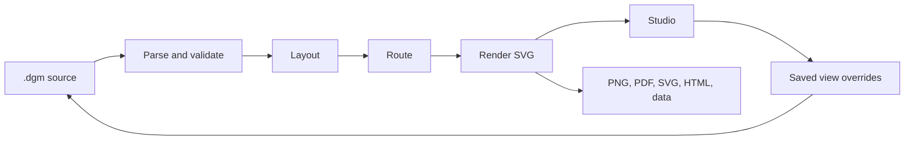

# Technical overview

Dumb Diagrams is a source-first architecture diagram engine with a local
browser editor. A `.dgm` file describes resources, boundaries, and
connections; the runtime validates, lays out, routes, and renders it. Studio
edits the same file and stores visual decisions as view overrides.

If you are creating diagrams, start with the [project README](../README.md).
For contribution commands, use [CONTRIBUTING.md](../CONTRIBUTING.md). For a
release, follow [RELEASE.md](./RELEASE.md).

## System shape

The durable contract is deterministic compilation: the same valid source,
catalog, and saved view produce the same geometry, routes, and SVG. Coordinates
and manual routes are optional overrides; they are not required for a useful
first render. Visual exports use the compiled geometry; source and data exports
serialize the source text or document model.



The repository is a pnpm workspace with five packages:

| Package | Owns |
| --- | --- |
| `packages/runtime` | Document model, parser, provider catalog, validation, layout, routing, rendering, and geometry checks |
| `packages/editor` | React Studio, source editing, workspace state, canvas interactions, and browser exports |
| `packages/cli` | The published `create-dumb-diagrams` command, project templates, and the loopback Studio server |
| `packages/brand` | Shared fonts, colors, and wordmark assets |
| `packages/website` | Static Astro site and public documentation |

## The document pipeline

The runtime processes a document in stable stages:

1. The parser reads the `.dgm` language into the document model.
2. Validation checks syntax, IDs, provider types, relationships, and
   containment before any output is produced.
3. Layout measures labels and cards, places nested groups from the inside out,
   and applies authored positions where the view asks for them.
4. The Manhattan router connects visible ports with horizontal and vertical
   segments. It scores candidate ports and gutters, resolves conflicts, and
   falls back to grid-based A* search for constrained diagrams.
5. Geometry invariants check that routes, cards, labels, and the canvas remain
   coherent. A routing budget may produce a stable warning; it does not reject
   an otherwise valid document or drop every edge.
6. The renderer emits SVG. PNG, JPEG, WebP, GIF, PDF, and HTML exports use
   that visual result. XML, JSON, URL, and `.dgm` exports serialize the
   document model or source text.

The source format intentionally separates architecture from presentation.
Resources and relationships remain readable text. A `view` block can preserve
positions, sizes, visibility, and exact route choices for stable IDs. If the
architecture changes, the compiler keeps compatible overrides and repairs or
ignores ones that no longer apply.

## Providers and catalog assets

The catalog is the source of truth for provider resource types, icons, labels,
containment rules, and parent relationships. Documents select one primary
grammar: `aws`, `azure`, `gcp`, or `cloud-agnostic`. AWS is the first-class
provider path. Azure, GCP, and cloud-agnostic authoring are experimental and
currently reuse AWS composition, layout, and routing conventions while using
their own catalog icons.

The vendored inputs live in `assets/catalog/`; generation produces the runtime
manifest and staging prepares browser-safe assets under
`packages/editor/public/`. Do not hand-edit generated manifests or staged
icons. Update the catalog inputs and run the documented generator and checks.
The full manifest is useful to tooling; the runtime receives a smaller index so
the editor entry chunk stays cacheable.

## Studio and local files

`dumbdiagrams studio` starts a generic local editor. It does not register a
project, discover files, or upload source. **Open** selects any `.dgm` file on
disk. The server listens on loopback and serves static Studio assets with
restrictive security headers; it does not expose a file or project API.

Chromium-based desktop browsers are the first-class Studio target and the
release browser gate. WebKit and Firefox are best-effort compatibility targets;
they do not receive the release support promise. Native Safari is not a claimed
release target. Browsers with the File System Access API can write back through
**Save** and choose a destination with **Save As**. Other browsers download the
updated source instead.

Studio keeps the last valid preview while a source edit is temporarily invalid.
Saving requires valid source. Before writing through a file handle it checks
whether the file changed or disappeared and asks the user to reload or
explicitly overwrite. Browser persistence, tabs, and undo history belong to the
editor; the CLI server remains stateless.

## Editor ownership and failures

`main.tsx` composes the Studio UI. Pure tab normalization and serialization live
in `state/workspace-model.ts`; `state/document-history.ts` owns source drafts,
undo/redo, and gesture transactions. The `workspace.ts` hook coordinates React
and the storage adapters in `workspace-persistence.ts`. Shared selection and
viewport types live in `model/types.ts`, below UI components.

`model/clipboard.ts` validates, remaps, and serializes clipboard payloads.
`model/asset-import.ts` validates embedded SVGs. Browser access and partial file
imports belong to `state/clipboard-actions.ts` and `state/document-import.ts`.
`state/document-actions.ts` prepares and compiles edits before source/history
publication. `state/use-document-commands.ts` owns publication, draft timing and
Auto-fix coordination. `state/catalog-actions.ts` resolves insertion placement
and selects the inserted item after successful publication; pure catalog
placement and grouping live in `model/catalog-placement.ts` and
`model/grouping.ts`. Selection merging belongs to `state/use-editor-selection.ts`.
Delayed clipboard and SVG imports are discarded when their source
or active tab changes. `interactions/overlay-gestures.ts` owns pointer listeners,
capture cleanup, and animation-frame previews; overlay rendering uses that
lifecycle without owning a second listener implementation.
`interactions/move-resize-gestures.ts` owns move/resize previews and completion;
cancellation closes the originating tab's transaction without an undo entry.

`styles.css` imports theme tokens, base elements, chrome, canvas, panels, and
dialogs in that order, followed by shared responsive and reduced-motion rules.
Keep component rules with their owner and preserve this cascade when moving
breakpoint overrides.

Expected input and I/O failures use neverthrow `Result` or `ResultAsync` with
local error codes. Handle or propagate each result; do not unwrap it unsafely or
convert it to an exception just to catch it again. Platform exceptions are
adapted at the browser/filesystem/storage boundary. The parser and sanitizer
retain thin throwing compatibility APIs; new fallible workflows use their
Result APIs. Remove internal compatibility adapters once their callers migrate;
changes to exported runtime APIs follow the versioning policy. Total geometry
functions still return ordinary values.

Cancellation, save conflicts, partial imports, and degraded recovery are
separate domain outcomes. Unexpected compiler failures produce failed
compilations, never successful diagrams with silently dropped edges. Worker
messages carry validated plain data, not Result instances or arbitrary error
objects. React error boundaries cover render failures; asynchronous/event
workflows must report their own failures.

## CLI and package boundary

The public commands are:

| Command | Contract |
| --- | --- |
| `dumbdiagrams init` | Creates a named project folder with agent entrypoints, `.dumbdiagrams/` guidance, and the `diagrams/` bundle convention |
| `dumbdiagrams studio` | Serves generic local Studio; use **Open** to choose a file |
| `dumbdiagrams validate <path>` | Parses and fully validates a file, or reads `-` from standard input |
| `dumbdiagrams format <path>` | Prints canonical source; `--check` verifies it and `--write` replaces it |
| `dumbdiagrams render <path>` | Writes deterministic SVG to stdout or `--output`/`-o` |

`dgm` is an alias for the same entrypoint. The published tarball contains the
CLI, bundled runtime, compiled Studio, templates, catalog assets, and a
buildable AGPL corresponding-source snapshot. `pnpm smoke:package` exercises
the packed consumer boundary, including aliases, invalid input, Studio, and a
clean source rebuild, representative source tests, Result checks, performance
fixtures, and browser-test discovery from the relocated snapshot.

## Repository layout and tests

Read [CONTRIBUTING.md](../CONTRIBUTING.md) for the canonical development
commands. The important paths are:

```text
assets/catalog/                  Provider inputs and notices
examples/curated/                Ten canonical diagram bundles
packages/runtime/src/            Parser, model, compiler, router, renderer
packages/runtime/test-fixtures.ts Shared test factories, outside production exports
packages/editor/src/             Studio and browser behavior
packages/cli/src/                CLI and local server
e2e/                             Workspace Studio browser tests
e2e-packed/                      Packed CLI-to-Studio browser tests
scripts/                         Catalog, packaging, and release checks
.artifacts/                      Ignored test, build, and package output
```

The curated corpus contains ten canonical examples: seven AWS, one Azure, one
GCP, and one cloud-agnostic. The checked-in baseline protects their source
bytes and semantic contracts.

The validation layers have distinct jobs:

| Check | Protects |
| --- | --- |
| `pnpm check:dependencies` | Declared dependencies and production package/model import boundaries |
| `pnpm check:results` | Typed Result consumption and no unsafe production unwraps |
| `pnpm test` | Runtime, editor model/state, CLI, and server behavior |
| `pnpm check` | Curated source validation and agent-init semantic contracts |
| `pnpm check:routing` | Reviewed routing warnings for checked-in examples |
| `pnpm test:coverage` | Node-focused coverage floors for runtime, editor logic, CLI, and recovery paths; browser orchestration is excluded |
| `pnpm test:e2e` | Chromium Studio journey and release browser gate |
| `pnpm test:e2e:compat` | Best-effort WebKit compatibility journey |
| `pnpm test:e2e:packed` | Published tarball, loopback server, and bundled Studio together |
| `pnpm smoke:package` | Local npm consumer flow and corresponding-source rebuild |
| `pnpm check:website` | Website build, content, links, assets, and consent behavior |

Playwright covers canvas orchestration, workspace interactions, drag and drop,
browser file behavior, exports, and worker orchestration that the unit coverage
report intentionally excludes. Chromium is the release gate; compatibility
failures in WebKit or Firefox should be assessed separately.

Generated output belongs under ignored build or artifact directories. Do not
commit coverage reports, Playwright traces, tarballs, staged catalog files, or
other generated check output. Keep package metadata, examples, and source
fixtures reviewable in the repository.

## Security and boundaries

The CLI reads paths supplied by the user and serves static assets on loopback.
Security reports involving path traversal, unintended network access, unsafe
SVG or HTML handling, dependency compromise, or release credentials are in
scope. See [SECURITY.md](../SECURITY.md) for the reporting policy. The runtime
does not call cloud APIs or maintain a hosted project service.
