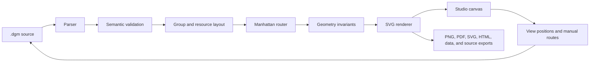

# Dumb Diagrams: technical overview

This guide is the map for someone joining the project or changing something
outside their usual corner of it. It explains the important decisions, where
each responsibility lives, and how a line of `.dgm` source becomes an editable
architecture diagram. It intentionally stays above the code: the source is the
place to learn exact algorithms and APIs; this page explains why the pieces are
arranged the way they are.

If you only want to create diagrams, start with the [project README](../README.md).
If you are preparing a release, use [RELEASE.md](./RELEASE.md).

## How to use this guide

This is one long page on purpose. It is easy to search today, and it gives a
future documentation site a sensible set of sections to turn into navigation:

| Section | What it answers |
| --- | --- |
| System shape | What the runtime, Studio, and CLI share |
| Package guide | Which package owns a behavior and where to start reading |
| Document and compile pipeline | How source moves through parsing, validation, layout, routing, and rendering |
| Routing and rendering decisions | Why connectors and output behave the way they do |
| Studio and local files | How the browser opens and saves portable files |
| Catalog and asset strategy | Where provider icons come from and how browser assets are handled |
| Build, tests, and packaging | Which checks protect the workspace and the published package |

The section names are part of the information architecture, not just editorial
formatting. New technical material should fit under the package or subsystem it
describes, with a short explanation here and the exact contract in a focused
file when one exists.

## The short mental model

Dumb Diagrams is a source-first diagram engine with a browser editor around it.

- A `.dgm` file is the durable source of truth.
- The runtime parses, validates, lays out, routes, and renders that source.
- Studio lets a person edit the same document visually or as text.
- `dumbdiagrams init` creates a named project folder for agents;
  `dumbdiagrams studio` serves the generic editor for files selected by the
  user.
- The npm tarball contains the CLI, the compiled Studio, templates, catalog
  assets, and buildable corresponding source.

The important boundary is that the engine does not infer a new arrangement on
every render. The same valid source and view overrides should produce the same
geometry, routes, and SVG.



## Design principles and boundaries

There are a few ideas worth keeping in mind before diving into individual
modules:

1. **The source file is the product.** A diagram should remain understandable,
   reviewable, and editable even when nobody opens Studio. The visual editor is
   a helpful view of the source, not a replacement for it.
2. **Defaults are deterministic.** Given the same valid document, catalog, and
   view overrides, the engine should make the same layout, routes, and SVG. That
   makes examples stable and makes changes much easier to review.
3. **Meaning comes before placement.** The document describes resources,
   containment, and relationships. Coordinates and manual routes are useful
   overrides, but they should not be required for a useful first render.
4. **The browser is optional.** Studio is convenient, and a local repository
   does not depend on a hosted service to stay usable.
5. **Exports use the same geometry.** PNG, PDF, HTML, and SVG are different
   delivery formats for the same compiled diagram. Export code should not invent
   a second layout system.

The project is not trying to be a general-purpose freeform drawing board. It is
an architecture diagram engine with a small, opinionated language and enough
manual control for the cases where a human has a better answer than a default.

## Getting started as a contributor

Requirements:

- Node.js 24 or newer
- pnpm 11.23.0, pinned by the root `packageManager` field

From the repository root:

```bash
fnm use  # or: nvm use
corepack enable  # once for this Node installation
pnpm install --frozen-lockfile
pnpm dev
```

`pnpm dev` starts the Vite-powered browser Studio with hot reload. It is the
fast loop for UI and browser-editor work.

This is a pnpm workspace. Do not use `npm install`, and do not treat
`npm run dev` as the supported development entry point: that script immediately
delegates back to pnpm. Use the pinned package manager so workspace linking,
engine checks, dependency policy, and the lockfile behave the same locally and
in CI.

When you need the compiled CLI and its static Studio server:

```bash
pnpm build
pnpm dev:cli
```

When you change packaging, templates, bundled Studio assets, or corresponding
source, test the npm artifact rather than only the workspace:

```bash
pnpm build
pnpm smoke:package
pnpm test:e2e:packed
```

Nothing is published by those commands. The generated tarball lives under
`.artifacts/packages/` and is consumed locally through `npx`.

## Testing the CLI

The CLI is the publishable `create-dumb-diagrams` package. `dumbdiagrams` is
the canonical command and `dgm` is its convenience shorthand.

| Loop | When to use it | What it proves |
| --- | --- | --- |
| Workspace binary | Daily CLI or Studio-server work | Compiled `packages/cli/dist/index.js` against workspace runtime and `packages/editor/dist` |
| Tarball + `npx` | Before release, after packaging/template changes | Exact consumer boundary (bundled runtime, `dist/studio`, templates) |
| Automated gates | Regression safety | Unit/integration, Playwright packed journey, `smoke:package` |

### Workspace CLI (fast iteration)

Build what changed, then invoke the dist entry directly or through `dev:cli`:

```bash
pnpm build
pnpm dev:cli

# equivalent:
node packages/cli/dist/index.js studio
```

`dev:cli` serves Studio from `packages/editor/dist` after an editor build. UI
hot reload remains `pnpm dev` (Vite only — no CLI bundling).

Global flags (any command):

```bash
node packages/cli/dist/index.js help
node packages/cli/dist/index.js --version
node packages/cli/dist/index.js -h
```

### Tarball CLI (consumer path)

```bash
set -e
cd "$(git rev-parse --show-toplevel)"
# If you use nvm or fnm, run the matching `nvm use` or `fnm use` here before continuing.
pnpm install --frozen-lockfile
pnpm build
pnpm smoke:package
ARTIFACT="$PWD/.artifacts/packages/create-dumb-diagrams-0.1.0.tgz"
npm install -g "$ARTIFACT"
dumbdiagrams --version
dgm --version
```

This is the recommended local consumer test. `pnpm smoke:package` creates the
tarball and runs the pack + consumer checks automatically, including the
`dumbdiagrams` and `dgm` entrypoints and the corresponding-source rebuild. The
commands do not publish to npm. If the global install reports a
permission problem or command conflict, stop; do not use `sudo` or `--force`.

For a temporary one-off test without changing the global install, the tarball
can still be invoked with `npx --package`, but use the artifact created by
`pnpm smoke:package`, not `@latest`:

```bash
export ARTIFACT="$(pwd)/.artifacts/packages/create-dumb-diagrams-0.1.0.tgz"
export CLI="npx --yes --package=$ARTIFACT dumbdiagrams"
```

### Command reference

The public CLI has two main commands:

| Command | Purpose |
| --- | --- |
| `dumbdiagrams init` | Create a named project folder for coding agents. The interactive prompt asks for its project name, uses a `dumb-diagrams-YYYY-MM-DD-HH-MM-SS` folder when blank, and writes agent entrypoints, `.dumbdiagrams/` guidance, and the documented `diagrams/` bundle convention. |
| `dumbdiagrams studio` | Start the generic local Studio. It is independent of the launch directory; use **Open** to select any `.dgm` file on disk. |

`dgm` invokes the same entrypoint as a convenience shorthand. There are no
file/folder positional arguments or project-registration options. Normal
`--help` and `--version` handling remains available.

### Try the public workflow manually

Use a temp directory so experiments stay outside the repo:

```bash
TMP="$(mktemp -d)"

# Reference
$CLI help
$CLI --version
npx --yes --package="$ARTIFACT" dgm --version   # alias

# Create a project folder below the current directory
cd "$TMP"
$CLI init

# Start generic Studio from any directory (Ctrl+C to stop)
$CLI studio
```

After publishing, install the package and use `dumbdiagrams`; `dgm` is the
optional shorthand.

### What automated tests cover

| Gate | CLI surface exercised |
| --- | --- |
| `packages/cli/src/index.test.ts` | `help`, `--version`, `init`, and `studio` |
| `packages/cli/src/studio-server.test.ts` | Loopback-only static serving, security headers, and absence of file/project APIs |
| `pnpm check` | Compiled CLI validates every checked-in `.dgm`, verifies the curated byte baseline, and runs the pilot semantic prompt ladder |
| `pnpm check:routing` | Compares routing/layout warnings with the visually reviewed warning baseline |
| `pnpm test:e2e` | Full Studio UI via **Vite** (not the CLI server) |
| `pnpm test:e2e:packed` | Tarball → `studio` server → bundled generic Studio in a browser |
| `pnpm smoke:package` | `npx` tarball: `init`, `studio`, `dgm` alias, and AGPL source rebuild |

The main gap for manual spot-checking: browser UX through **workspace** `dev:cli`
after editor changes (`pnpm build && pnpm dev:cli …`). Packed E2E covers the
tarball path; Vite E2E covers editor UI without the CLI bundle.

## Technology choices

The stack is intentionally small. Each tool solves a concrete problem, and
there is no extra orchestration layer hiding how the packages fit together.


| Technology | What it does here |
| --- | --- |
| TypeScript and native ESM | Shared language and module format across the runtime, CLI, editor, tests, and scripts |
| Node.js 24 | CLI, local Studio HTTP server, packaging, catalog generation, and repository tooling |
| pnpm workspaces | Links the application and website packages and enforces the locked dependency graph |
| Astro 7 and Pagefind | Static website, Markdown documentation, and local full-text search |
| React 19 | Studio UI and interactive editor composition |
| Vite 8 | Editor development server and production browser bundle, using Rolldown/Oxc |
| CodeMirror 6 | `.dgm` source editing inside Studio |
| Vitest 4 with V8 coverage | Runtime, editor-logic, CLI, and Studio-server tests |
| Playwright with Chromium and WebKit | Cross-engine browser behavior and exports; Chromium also covers the packed CLI-to-Studio journey |
| esbuild | Produces the standalone CLI bundle placed in the npm tarball |
| GitHub Actions and Pages | Linux/Windows verification, exact-tag release checks, and static Studio deployment |

There is deliberately no monorepo task framework. Four packages and a small
set of root scripts are still easier to understand directly through pnpm.

### Why Vite 8, and what React has to do with it

React and Vite solve different problems. React 19 is the UI library; Vite is
the development server and browser build tool around it. The old setup was
already on React 19, but still had Vite 6 and the older React plugin as a
stable, pinned tooling choice. That was not a React compatibility requirement,
and there was no product reason to stay on Vite 6 once the rest of the
repository was ready for the current toolchain.

Vite 8 moves the production bundling path to Rolldown and uses Oxc for several
transforms. In practice, the main benefit we expect is a shorter edit/build
loop and less bundler work in CI. It does not automatically make the code run
faster in a user's browser, and it is not a reason to upgrade React by itself.
Browser performance still depends on the JavaScript and assets we ship, so the
catalog chunk and the editor entry remain explicit, measured boundaries. See
the [Vite 8 announcement](https://vite.dev/blog/announcing-vite8) for the
upstream rationale and the repository's build and asset checks for the local
measurements.

## Repository structure

```text
.
├── assets/catalog/             Reviewed provider assets and source locks
├── docs/                       Architecture, maintenance, versioning, release
├── e2e/                        Browser Studio tests against Vite
├── e2e-packed/                 Browser test against the packed CLI and Studio
├── examples/                   Checked-in diagrams and their creation prompts
├── packages/
│   ├── runtime/                Model, DSL, catalog, layout, routing, rendering
│   ├── editor/                 React Studio and browser export surface
│   ├── cli/                    Published command and static Studio server
│   ├── brand/                  Shared fonts, palette, and wordmark (see STYLE_GUIDE.md)
│   └── website/                Static Astro website and public documentation
├── scripts/                    Build, catalog, package, policy, and release tools
├── playwright.config.ts        Static browser test configuration
├── playwright.packed.config.ts Packed Studio test configuration
└── vitest.config.ts            Unit/integration coverage scope and thresholds
```

Generated output is ignored:

- package builds go to each package’s `dist/` directory;
- staged catalog browser assets go to `packages/editor/public/`;
- coverage, Playwright traces, tarballs, and other checks go to `.artifacts/`.

## Package boundaries

### `@dumb-diagrams/runtime`

The runtime is the engine and has no React dependency. Its public subpaths make
the stages explicit:

| Subpath | Responsibility |
| --- | --- |
| `core` | Document types, defaults, limits, port helpers, and validation |
| `catalog` | Provider inventory, lookup, and icon URL handling |
| `dsl` | `.dgm` tokenizer/parser and canonical printer |
| `grammar-aws` | Shared visual tokens and conventions, first-class for AWS and currently reused by experimental providers |
| `layout` | Nested group sizing, resource placement, and authored overrides |
| `route` | Deterministic orthogonal connector routing |
| `render` | Compilation, invariant checks, SVG, and portable rendering |

The CLI imports the compiled runtime. During editor development, Vite aliases
runtime subpaths directly to TypeScript source so a runtime edit appears in the
browser without publishing or relinking a package.

#### `core`: the shared vocabulary and safety checks

`core` defines the document types used by every consumer: resources, groups,
edges, annotations, views, geometry, and validation issues. It also owns the
small limits and helpers that stop an invalid or unexpectedly large document
from making its way into the rest of the pipeline. Keeping this vocabulary in
one place prevents the editor and CLI from quietly inventing different meanings
for the same source.

#### `dsl`: the source language

`dsl` turns `.dgm` text into a document and can print that document back in a
canonical form. The parser is deliberately narrow and readable. It is meant to
make architecture intent easy for people and language models to author, not to
become a second general-purpose drawing format.

#### `catalog` and `grammar-aws`: provider knowledge

`catalog` is the generated inventory of provider resources, groups, labels,
parent rules, and icon paths. Documents select `aws`, `azure`, `gcp`, or
`cloud-agnostic`; the selected provider controls the authored catalog types and
icons. `grammar-aws` contains the visual conventions and style defaults shared
by all four today. AWS is first-class, while Azure, GCP, and cloud-agnostic are
experimental compatibility paths until their conventions are refined.

#### `layout`: turning structure into space

`layout` measures cards and group headers, walks containment, and gives the
document a useful initial arrangement. It knows about the different group kinds
and flow directions, but it does not decide how connectors should travel. View
overrides are applied after the authored structure has been laid out, so a
manual move stays meaningful without making every other item manual.

#### `route`: keeping relationships readable

`route` is the connector planner. It works from the geometry produced by
`layout`, reserves space for constrained connections, and chooses orthogonal
paths that avoid content and unnecessary visual noise. Its public result is
just route geometry; the policy and scoring details live in the dedicated
[`ROUTING.md`](../packages/runtime/ROUTING.md) contract.

#### `render`: one compiled result for many consumers

`render` coordinates the pipeline, checks geometry invariants, and produces
SVG. It also contains the browser/portable asset boundary: Studio can point at
catalog files while a standalone export can inline the same icons and sanitize
embedded SVG before it leaves the runtime.

### `@dumb-diagrams/editor`

The editor is the React application called Studio. Important internal
boundaries are:

- `main.tsx` coordinates panels, active workspace state, and local Studio mode;
- `editor-model.ts` contains document mutations rather than UI rendering;
- `state/workspace.ts` owns tabs, history, saved state, and persistence;
- `interactions/` handles selection, edge targeting, and manual route editing;
- `diagram-compiler.ts` runs the browser compilation pipeline and keeps a small
  LRU cache of recent results;
- `state/export-actions.ts` implements all advertised export formats;
- `panels/`, `canvas/`, and `ui/` contain focused React surfaces.

Keep new domain behavior out of `main.tsx` when it can live in one of those
testable modules. See [MAINTAINING.md](./MAINTAINING.md) for the ownership map.

#### UI shell and editor model

`main.tsx` is the coordinator. It connects menus, panels, the active workspace,
compilation status, and local-file capabilities. It should not become the place
where document rules accumulate. Mutations belong in `editor-model.ts`, while
small UI surfaces belong in panels or focused components.

#### Workspace state and persistence

`state/workspace.ts` treats tabs, undo/redo, saved state, and browser persistence
as one workspace concern. A browser session can hold several diagrams without
changing their source format. File handles are associated with open tabs only
for the lifetime of the page and do not create a second editor model.

#### Canvas and interactions

`canvas/` owns the viewport: pan, zoom, fit-to-content, and catalog drops. The
diagram itself is still the runtime’s SVG output. `interactions/` translates
pointer intent into document operations such as selecting an item, moving it,
choosing a connector, or pinning a route. Keeping these operations separate
from the viewport makes the same model usable by keyboard actions and tests.

#### Compilation and exports

`diagram-compiler.ts` gives the browser the same runtime stages as the CLI and
keeps a small cache for repeated edits. `state/export-actions.ts` is the final
adapter layer: it takes the compiled SVG and produces the formats the browser
can support. Export buttons should stay here instead of growing special cases
inside the runtime renderer.

### `create-dumb-diagrams` CLI

This is the publishable package. Its canonical `dumbdiagrams` command exposes
`init` for creating a project folder with agent setup and `studio` for the
generic local editor. `dgm` invokes the same entrypoint as a convenience
shorthand.

OS-specific browser launch commands are isolated in `platform-launch.ts` so
Windows, macOS, and Linux syntax can be tested without
opening GUI applications in CI.

#### Commands and local files

The CLI is the user-facing bridge to local files. It creates a named project
folder below the current directory, writes agent guidance and the default
`diagrams/<name>/{diagram.dgm,architecture-brief.md}` convention there, then
starts Studio without inferring a file or project from the launch directory.
The persisted brief is diagnostic
metadata describing interpreted semantics; the `.dgm` remains authoritative.
The command layer should remain thin: document behavior belongs to the runtime,
while browser state belongs to the editor.

#### The local Studio server

`studio-server.ts` serves only the compiled editor on loopback. It has no file,
project, discovery, or workspace API. Browser file handles provide direct local
Open and Save where supported; the file-input and download path is the fallback.

#### The published boundary

The package preparation step makes the CLI self-contained: it bundles the
runtime, copies the compiled Studio and templates, includes the reviewed
catalog, and adds the corresponding source required by the AGPL. A change that
works in the workspace but is missing from the tarball is still a broken user
experience, which is why packed tests are part of the normal release path.

## The `.dgm` document model

The DSL is intentionally smaller than a general drawing format. It describes
architecture meaning, containment, flow, and the human overrides worth keeping.

```dgm
diagram payments {
  grammar aws
  flow lr
  title "Payments platform"

  generic.user customer "Customer"
  aws.region use1 "AWS Region" {
    cloud-agnostic.boundary app "Application" {
      aws.api-gateway gateway "Payments API"
      aws.aws-lambda handler "Payment handler"
    }
    aws.dynamodb ledger "Payment ledger"
  }

  customer -> gateway { id request step 1 kind flow }
  gateway -> handler { id invoke step 2 kind flow }
  handler -> ledger { id persist step 3 kind flow }
}

view default {
}
```

After parsing, the runtime works with a `DiagramDocument` containing resources,
groups, edges, annotations, optional embedded SVG assets, and views. A view
stores positions, sizes, visibility, z-order, and manual connector routes.
Semantic structure therefore stays separate from presentation overrides, while
both still travel in one reviewable source file.

Validation runs before layout. It checks IDs, references, containment, catalog
types, limits, labels, ports, and other document constraints. The editor can
keep displaying its last valid compilation while a person repairs temporarily
invalid source.

## How the engine compiles a diagram

The Node runtime’s `compileDiagram` function is the clearest reference pipeline:

1. Look up the generated catalog.
2. Validate the parsed document.
3. Lay out nested groups and resources.
4. Route every edge against the placed geometry.
5. Attach the routes to the layout.
6. Check geometric invariants such as collisions and crossings.
7. Render the complete result as SVG.

Studio follows the same stages, with editor-specific additions: snap-to-grid,
artboard expansion for authored content, browser icon URLs, and compilation
caching.

### Layout

Layout starts with semantic containment. Groups provide nested coordinate
spaces and headers; resources are measured as complete cards, including their
icons and labels. Flow direction (`lr` or `tb`), group kinds, resource roles,
and view overrides influence placement. Manual positions remain exact, while
unplaced content receives the deterministic opinionated layout.

### Manhattan routing

All automatic connectors are orthogonal: horizontal and vertical segments
joined at right angles. The router does more than find the shortest path.

1. It derives visible source and target ports plus clear gutters around resource
   cards and group headers.
2. It generates inexpensive template candidates for common shapes.
3. It scores candidates for collisions, crossings, unrelated junctions,
   crowded or shared corridors, endpoint crowding, bends, distance, and
   backtracking.
4. If templates are blocked, it uses grid-based A* search with the same costs.
5. It simplifies shortcuts only when doing so does not reintroduce a conflict.

Pinned manual routes and exact fractional ports claim space first. Less flexible
and more constrained flows are routed before easy local edges, while final
rendering preserves document order. A face-only port is a preference; an exact
fractional port is a constraint.

The router is deterministic, but dense diagrams can make perfection impossible.
Those cases become explicit invariant warnings. Checked-in examples have a
reviewed warning fingerprint in `examples/routing-warnings.json`, so a new or
removed warning requires deliberate visual review. The precise priority list is
in [`packages/runtime/ROUTING.md`](../packages/runtime/ROUTING.md).

### Rendering and export

The renderer produces SVG from the final geometry. Provider icons are resolved
through the generated catalog, and embedded SVG is sanitized before use.
Studio’s export layer can then keep the vector output or derive PNG, JPEG, WebP,
GIF, PDF, standalone HTML, XML, URL payloads, JSON, and canonical `.dgm` source.

### Why SVG over Canvas for now

The word “canvas” can be a little confusing here. Studio has a canvas-like
viewport for panning and zooming, but the diagram inside that viewport is an SVG
tree. We chose that split deliberately:

- **The output stays portable.** The same SVG can be displayed in Studio,
  downloaded directly, embedded in standalone HTML, or used as the source for
  other export formats.
- **Text and icons stay sharp.** Architecture diagrams are mostly labels,
  connector lines, badges, and provider icons. SVG keeps them crisp at any zoom
  level without maintaining separate raster resolutions.
- **The browser can understand the scene.** SVG elements can carry stable IDs
  and data attributes, which makes selection, hit testing, previews, and
  debugging much simpler than mapping every pointer coordinate back to a
  painted bitmap.
- **The renderer has one geometry contract.** The runtime can produce the same
  shape tree for the CLI and the browser. A Canvas renderer would need a second
  drawing implementation and a separate story for portable exports.

There are real trade-offs. Very large diagrams can put pressure on the DOM, and
Canvas could become attractive for a dense overview or a high-frequency visual
effect. That is a future option, not a current requirement. The runtime keeps
layout and routing independent from SVG, so a later Canvas or hybrid renderer
can be added if measurements show that it solves an actual problem. Until then,
SVG gives us the clearest path from source to screen to export.

## Browser Studio versus local Studio

The same editor bundle runs in two modes:

Studio uses the File System Access API when the browser provides it. Open keeps
the selected file handle with that tab, Save writes through the handle, and Save
As requests a new handle. Handles are intentionally not persisted across page
reloads. Browsers without that API use the same `.dgm` validation and tab flow,
but opening uses a hidden file input and saving downloads a portable source file.

The CLI server binds to `127.0.0.1`, serves static assets only, and emits a
restrictive content-security policy plus anti-framing/content-sniffing headers.
It neither receives file contents nor learns where selected `.dgm` files live.

## Catalog pipeline

`assets/catalog/` contains reviewed upstream inputs, source locks, collision
policy, and notices. `scripts/generate-catalog.mjs` converts that inventory into
the runtime manifest. `scripts/stage-catalog-assets.mjs` creates browser-safe
names and stages the assets in the editor’s public directory.

The catalog index is intentionally a separate Vite chunk. It is large, changes
on a different cadence from the editor, and should remain cacheable when UI code
changes. Do not hand-edit generated manifest or staged public files; update the
catalog sources and run the catalog workflow.

```bash
pnpm icons:check
pnpm icons:update   # only when deliberately updating catalog inputs
pnpm icons:build
```

## Asset and image strategy

There are three different kinds of image in this project, and treating them
the same would make the result worse:

| Asset | Current format | Why |
| --- | --- | --- |
| Provider and group catalog icons | SVG | They are small vector symbols, need to remain sharp at different display sizes, and are sometimes inlined into portable SVG exports |
| Dumb Diagrams branding | Canonical transparent PNG plus optimized PNG derivatives and a small PNG favicon | The logo is used in the app shell, website, and README; keeping compact named derivatives makes the standalone CLI and static deployment predictable |
| User-embedded diagram assets | Sanitized SVG inside `.dgm` | Embedded assets are part of the document and need to travel with it; the runtime limits their size and removes unsafe SVG content before rendering |

The supplied high-resolution logo is stored as the canonical source at
`packages/brand/assets/logo-dumb-diagrams-source.png`. The checked-in, stable
consumer derivatives are kept at
`packages/editor/public/logo_dumbdiagrams.png`,
`packages/editor/public/favicon.png`,
`packages/website/src/assets/logo_dumbdiagrams_faq.png`, and
`packages/website/src/assets/logo_dumbdiagrams_highres.png`. The website build
also copies the compact Studio assets to ignored `public/` outputs. Each file is
intentionally sized for its app-shell or documentation surface rather than
reused at source dimensions.

The catalog’s PNG files are upstream inputs, not browser payloads. The generated
manifest selects the reviewed SVG variants and the staging script copies only
those variants into `packages/editor/public/catalog-icons/`. Do not bulk-convert
the catalog to WebP: that would give vector icons a raster ceiling and would
break the clean path to self-contained SVG exports.

Vite’s `public` directory is copied to the build output as-is, while imported
assets participate in the build graph and can be processed. That distinction is
why the branding derivatives are explicit files rather than an assumption that
Vite will automatically create modern formats. The generated Studio and the
CLI’s static server both need to serve the same named files, so stable paths are
useful for these small app-shell assets.

The generated catalog is a special case. Generation keeps the full JSON
manifest for audits and tooling, and also writes a smaller runtime manifest
containing only the aliases and entries needed by the catalog module. The
runtime version is loaded through `JSON.parse` so Vite can ship it as a compact
string instead of turning every catalog entry into JavaScript object source.
This keeps the catalog chunk cacheable without making the browser bundle carry
metadata used only by repository checks.

### What we checked for Vite image optimization

There are good tools in the Vite ecosystem, but they solve slightly different
problems:

- [`vite-imagetools`](https://github.com/JonasKruckenberg/imagetools/tree/main/packages/vite)
  is the nicest fit for responsive images and compile-time format conversion.
  Its current major release is Sharp-backed and requires Vite 8 or newer, so it
  is compatible with the current toolchain. It is still more useful once the
  docs site has many owned raster images than it is for this small app shell.
- [`vite-plugin-image-optimizer`](https://github.com/FatehAK/vite-plugin-image-optimizer)
  supports Vite 3+ and can process public assets with Sharp and SVGO. It is a
  reasonable option for a site with many owned raster images, but its broad
  public-directory mode would also process the curated catalog and adds native
  image-tooling dependencies to every install.
- [`Sharp`](https://sharp.pixelplumbing.com/) is the underlying production-grade
  image library used by both approaches. It is a good foundation when the
  future docs site has real photos, screenshots, responsive widths, or many
  content images.

For the current app, the measured scope is one small branding raster and a
large vector catalog. We therefore keep the asset pipeline intentionally
scoped: ship a smaller logo and favicon now, keep catalog SVG untouched, and
revisit `vite-imagetools` or a narrowly configured optimizer when the docs site
actually introduces enough raster content to justify it. This avoids adding a
large build dependency for a single 19 KB source image while leaving a clear
upgrade path.

## Build and packaging

`pnpm build` runs the dependency order explicitly:

1. generate the catalog;
2. compile the runtime with TypeScript;
3. stage catalog assets and build Studio with Vite;
4. compile the CLI with TypeScript.

Packing `packages/cli` invokes `scripts/prepare-cli-package.mjs`. That script:

- bundles the compiled CLI and runtime with esbuild;
- copies the production Studio into `dist/studio`;
- copies agent-init templates and curated examples;
- checks the packaged legal files;
- builds the AGPL corresponding-source snapshot under `dist/source`.

The source snapshot includes the vendored inputs required to rebuild the
package. Because npm tarballs omit the repository’s dot-prefixed `.npmrc`, it
ships as `registry.npmrc`; rebuilders copy it to `.npmrc` before dependency
resolution.

## Tests and release gates

| Gate | Boundary covered |
| --- | --- |
| `pnpm test` | Runtime, editor logic, CLI, and local Studio HTTP integration |
| `pnpm test:coverage` | Node-focused CLI, runtime, editor-model, and crash-recovery coverage against enforced thresholds; browser-bound canvas, workspace, drag/drop, and worker orchestration are exercised by the Playwright suites |
| `pnpm check` | Every checked-in example through the compiled CLI |
| `pnpm check:routing` | Exact fingerprint of reviewed example routing warnings |
| `pnpm check:performance` | Median compile time for the representative examples against a 250 ms CI ceiling |
| `pnpm check:assets` | Branding image dimensions and byte budgets |
| `pnpm test:e2e` | Chromium and WebKit Studio interactions and every format supported by each engine (WebP is hidden where encoding is unavailable) |
| `pnpm test:e2e:packed` | Real tarball → CLI server → bundled generic Studio |
| `pnpm smoke:package` | Local `npx` consumer flows, tarball contents, aliases, failure codes, and clean corresponding-source rebuild |
| `pnpm check:release` | Aggregate local Linux/macOS release gate |

CI repeats the Linux gates, runs the publishable CLI smoke on Windows, and makes
new tag deployments pass the release verification against the exact tag before
GitHub Pages publishes. Explicit rollbacks rebuild a previously verified tag
without assuming it contains the newest test scripts.

## Where to go next

- [MAINTAINING.md](./MAINTAINING.md) maps behavior to implementation and tests.
- [RELEASE.md](./RELEASE.md) is the package and deployment checklist.
- [VERSIONING.md](./VERSIONING.md) defines workspace version policy.
- [`packages/runtime/ROUTING.md`](../packages/runtime/ROUTING.md) is the exact
  connector-routing contract.
- [`assets/catalog/README.md`](../assets/catalog/README.md) explains catalog
  provenance and updates.

## Website and public documentation

`packages/website` is an independent static Astro package. Its public articles
adapt this guide into three sections: Start here, Make diagrams, and Under the
hood. Exact contracts such as `packages/runtime/ROUTING.md` remain the source
for detailed implementation rules. Update the relevant public article when
those behaviors change.

Run `pnpm dev:website` for development or `pnpm check:website` for diagnostics,
a production build, and link/example/payload checks. Pagefind search is built
after Astro and tested using `pnpm preview:website`. Homepage diagrams are
compiled from real `.dgm` files at build time; the runtime is not shipped to
website visitors.

The site stays out of `pnpm build` and the existing Studio deployment. Its
source is included in the corresponding-source snapshot to keep the workspace
complete. Self-hosted fonts and static HTML keep the initial browser work small.
Partytown is installed but opt-in; no analytics code is enabled. Hosting and
base-path configuration are documented in `packages/website/README.md`.

### Shared visual identity

Studio and the website import `@dumb-diagrams/brand/styles.css` for the Manrope and IBM Plex Mono fonts, logo palette, and official `dumbdiagrams.` wordmark. App layout and component styles remain local. The exact typography, color roles, existing component inventory, and motion/accessibility conventions are documented in [STYLE_GUIDE.md](./STYLE_GUIDE.md). Diagram label typography remains an independent renderer concern.
