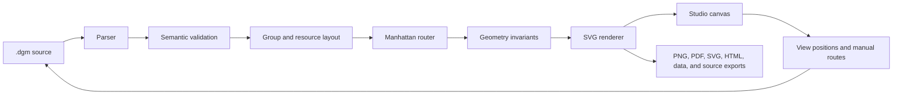

# Dumb Diagrams: technical overview

This guide is the programmer’s map of Dumb Diagrams. It explains how to get a
development environment running, where responsibilities live, and how a line of
`.dgm` source becomes an editable architecture diagram.

If you only want to create diagrams, start with the [project README](../README.md).
If you are preparing a release, use [RELEASE.md](./RELEASE.md).

## The short mental model

Dumb Diagrams is a source-first diagram engine with a browser editor around it.

- A `.dgm` file is the durable source of truth.
- The runtime parses, validates, lays out, routes, and renders that source.
- Studio lets a person edit the same document visually or as text.
- The CLI creates projects, validates and renders files, and serves Studio next
  to real files on disk.
- The npm tarball contains the CLI, the compiled Studio, templates, catalog
  assets, and buildable corresponding source.

The important boundary is that the engine does not infer a new arrangement on
every render. The same valid source and view overrides should produce the same
geometry, routes, and SVG.



## Getting started as a contributor

Requirements:

- Node.js 24 or newer
- pnpm 11.23.0, pinned by the root `packageManager` field

From the repository root:

```bash
pnpm install --frozen-lockfile
pnpm dev
```

`pnpm dev` starts the Vite-powered browser Studio with hot reload. It is the
fast loop for UI and browser-editor work.

This is a pnpm workspace. Do not use `npm install`, and do not treat
`npm run dev` as the supported development entry point: that script immediately
delegates back to pnpm. Use the pinned package manager so workspace linking,
engine checks, dependency policy, and the lockfile behave the same locally and
in CI.

When you need the compiled CLI and its local-file bridge:

```bash
pnpm build
pnpm dev:cli examples/diagrams/aws-high-availability-web-app.dgm
```

When you change packaging, templates, bundled Studio assets, or corresponding
source, test the npm artifact rather than only the workspace:

```bash
pnpm build
pnpm smoke:package
pnpm test:e2e:packed
```

Nothing is published by those commands. The generated tarball lives under
`.artifacts/packages/` and is consumed locally through `npx`.

## Technologies in one minute

| Technology | What it does here |
| --- | --- |
| TypeScript and native ESM | Shared language and module format across the runtime, CLI, editor, tests, and scripts |
| Node.js 24 | CLI, local Studio HTTP server, packaging, catalog generation, and repository tooling |
| pnpm workspaces | Links the three packages and enforces the locked dependency graph |
| React 19 | Studio UI and interactive editor composition |
| Vite 6 | Editor development server and production browser bundle |
| CodeMirror 6 | `.dgm` source editing inside Studio |
| Vitest with V8 coverage | Runtime, editor-logic, CLI, and Studio-server tests |
| Playwright with Chromium | Full browser behavior, exports, and the packed CLI-to-Studio journey |
| esbuild | Produces the standalone CLI bundle placed in the npm tarball |
| GitHub Actions and Pages | Linux/Windows verification, exact-tag release checks, and static Studio deployment |

There is deliberately no monorepo task framework. Three packages and a small
set of root scripts are still easier to understand directly through pnpm.

## Repository structure

```text
.
├── assets/catalog/             Reviewed provider assets and source locks
├── docs/                       Architecture, maintenance, versioning, release
├── e2e/                        Browser Studio tests against Vite
├── e2e-packed/                 Browser test against the packed CLI and Studio
├── examples/                   Checked-in diagrams and their creation prompts
├── packages/
│   ├── runtime/                Model, DSL, catalog, layout, routing, rendering
│   ├── editor/                 React Studio and browser export surface
│   └── cli/                    Published command and local Studio server
├── scripts/                    Build, catalog, package, policy, and release tools
├── playwright.config.ts        Static browser test configuration
├── playwright.packed.config.ts Packed Studio test configuration
└── vitest.config.ts            Unit/integration coverage scope and thresholds
```

Generated output is ignored:

- package builds go to each package’s `dist/` directory;
- staged catalog browser assets go to `packages/editor/public/`;
- coverage, Playwright traces, tarballs, and other checks go to `.artifacts/`.

## Package boundaries

### `@dumb-diagrams/runtime`

The runtime is the engine and has no React dependency. Its public subpaths make
the stages explicit:

| Subpath | Responsibility |
| --- | --- |
| `core` | Document types, defaults, limits, port helpers, and validation |
| `catalog` | Provider inventory, lookup, and icon URL handling |
| `dsl` | `.dgm` tokenizer/parser and canonical printer |
| `grammar-aws` | AWS-oriented grammar tokens and conventions |
| `layout` | Nested group sizing, resource placement, and authored overrides |
| `route` | Deterministic orthogonal connector routing |
| `render` | Compilation, invariant checks, SVG, and portable rendering |

The CLI imports the compiled runtime. During editor development, Vite aliases
runtime subpaths directly to TypeScript source so a runtime edit appears in the
browser without publishing or relinking a package.

### `@dumb-diagrams/editor`

The editor is the React application called Studio. Important internal
boundaries are:

- `main.tsx` coordinates panels, active workspace state, and local Studio mode;
- `editor-model.ts` contains document mutations rather than UI rendering;
- `state/workspace.ts` owns tabs, history, saved state, and persistence;
- `interactions/` handles selection, edge targeting, and manual route editing;
- `diagram-compiler.ts` runs the browser compilation pipeline and keeps a small
  LRU cache of recent results;
- `state/export-actions.ts` implements all advertised export formats;
- `panels/`, `canvas/`, and `ui/` contain focused React surfaces.

Keep new domain behavior out of `main.tsx` when it can live in one of those
testable modules. See [MAINTAINING.md](./MAINTAINING.md) for the ownership map.

### `dumbdiagrams` CLI

This is the publishable package and exposes both `dumbdiagrams` and `dgm`.

- `init` creates an agent-ready project, examples, catalog references, and a
  starter diagram.
- `studio` serves the bundled editor and connects it to a `.dgm` file or folder.
- `validate` / `check` parse, validate, compile, and report routing notes.
- `format` prints or writes canonical `.dgm` source.
- `render` produces portable SVG.
- `fixtures` renders built-in development fixtures.

OS-specific browser/editor launch commands are isolated in
`platform-launch.ts` so Windows, macOS, and Linux syntax can be tested without
opening GUI applications in CI.

## The `.dgm` document model

The DSL is intentionally smaller than a general drawing format. It describes
architecture meaning, containment, flow, and the human overrides worth keeping.

```dgm
diagram payments {
  grammar aws
  flow lr
  title "Payments platform"

  generic.user customer "Customer"
  aws.region use1 "AWS Region" {
    group app "Application" {
      aws.api-gateway gateway "Payments API"
      aws.aws-lambda handler "Payment handler"
    }
    aws.dynamodb ledger "Payment ledger"
  }

  customer -> gateway { id request step 1 kind flow }
  gateway -> handler { id invoke step 2 kind flow }
  handler -> ledger { id persist step 3 kind flow }
}

view default {
}
```

After parsing, the runtime works with a `DiagramDocument` containing resources,
groups, edges, annotations, optional embedded SVG assets, and views. A view
stores positions, sizes, visibility, z-order, and manual connector routes.
Semantic structure therefore stays separate from presentation overrides, while
both still travel in one reviewable source file.

Validation runs before layout. It checks IDs, references, containment, catalog
types, limits, labels, ports, and other document constraints. The editor can
keep displaying its last valid compilation while a person repairs temporarily
invalid source.

## How the engine compiles a diagram

The Node runtime’s `compileDiagram` function is the clearest reference pipeline:

1. Look up the generated catalog.
2. Validate the parsed document.
3. Lay out nested groups and resources.
4. Route every edge against the placed geometry.
5. Attach the routes to the layout.
6. Check geometric invariants such as collisions and crossings.
7. Render the complete result as SVG.

Studio follows the same stages, with editor-specific additions: snap-to-grid,
artboard expansion for authored content, browser icon URLs, and compilation
caching.

### Layout

Layout starts with semantic containment. Groups provide nested coordinate
spaces and headers; resources are measured as complete cards, including their
icons and labels. Flow direction (`lr` or `tb`), group kinds, resource roles,
and view overrides influence placement. Manual positions remain exact, while
unplaced content receives the deterministic opinionated layout.

### Manhattan routing

All automatic connectors are orthogonal: horizontal and vertical segments
joined at right angles. The router does more than find the shortest path.

1. It derives visible source and target ports plus clear gutters around resource
   cards and group headers.
2. It generates inexpensive template candidates for common shapes.
3. It scores candidates for collisions, crossings, unrelated junctions,
   crowded or shared corridors, endpoint crowding, bends, distance, and
   backtracking.
4. If templates are blocked, it uses grid-based A* search with the same costs.
5. It simplifies shortcuts only when doing so does not reintroduce a conflict.

Pinned manual routes and exact fractional ports claim space first. Less flexible
and more constrained flows are routed before easy local edges, while final
rendering preserves document order. A face-only port is a preference; an exact
fractional port is a constraint.

The router is deterministic, but dense diagrams can make perfection impossible.
Those cases become explicit invariant warnings. Checked-in examples have a
reviewed warning fingerprint in `examples/routing-warnings.json`, so a new or
removed warning requires deliberate visual review. The precise priority list is
in [`packages/runtime/ROUTING.md`](../packages/runtime/ROUTING.md).

### Rendering and export

The renderer produces SVG from the final geometry. Provider icons are resolved
through the generated catalog, and embedded SVG is sanitized before use.
Studio’s export layer can then keep the vector output or derive PNG, JPEG, WebP,
GIF, PDF, standalone HTML, XML, URL payloads, JSON, and canonical `.dgm` source.

## Browser Studio versus local Studio

The same editor bundle runs in two modes:

| Mode | Started with | Persistence |
| --- | --- | --- |
| Browser/static | `pnpm dev`, Vite preview, or GitHub Pages | Browser workspace and explicit downloads |
| Local-file | `dumbdiagrams studio <file-or-folder>` | Reads and writes real `.dgm` files through the CLI server |

On startup, Studio probes `/api/session`. A static server has no compatible API,
so the editor quietly stays in browser mode. The CLI serves both the compiled
assets and the API on one origin, enabling local-file mode without CORS or a
remote service.

The local bridge exposes a deliberately small API:

| Endpoint | Purpose |
| --- | --- |
| `GET /api/session` | Detect local mode and describe the active project/file |
| `GET /api/document` | Load source and its content-hash revision |
| `PUT /api/document` | Validate and revision-check a save; optionally Save As |
| `GET /api/files` | List sibling `.dgm` files |
| `POST /api/select` | Switch the connected file |
| `GET /api/events` | Stream external changes and reconnection state with SSE |

Writes are atomic. Each save includes the revision it was based on; a stale save
receives HTTP 409 and Studio asks whether to reload the disk version or keep the
browser version. The bridge watches the diagram's containing directory so
editors that atomically replace a file do not detach the watcher. API reads,
saves, and SSE reconnects refresh from disk before using a revision. EventSource
reconnects automatically after laptop sleep or a dropped local connection, and
the SSE readiness event resynchronizes both the document and visible connection
state. A low-frequency heartbeat helps detect a half-open connection; browser
internet-status events are intentionally ignored because Studio only needs
localhost.

## Catalog pipeline

`assets/catalog/` contains reviewed upstream inputs, source locks, collision
policy, and notices. `scripts/generate-catalog.mjs` converts that inventory into
the runtime manifest. `scripts/stage-catalog-assets.mjs` creates browser-safe
names and stages the assets in the editor’s public directory.

The catalog index is intentionally a separate Vite chunk. It is large, changes
on a different cadence from the editor, and should remain cacheable when UI code
changes. Do not hand-edit generated manifest or staged public files; update the
catalog sources and run the catalog workflow.

```bash
pnpm icons:check
pnpm icons:update   # only when deliberately updating catalog inputs
pnpm icons:build
```

## Build and packaging

`pnpm build` runs the dependency order explicitly:

1. generate the catalog;
2. compile the runtime with TypeScript;
3. stage catalog assets and build Studio with Vite;
4. compile the CLI with TypeScript.

Packing `packages/cli` invokes `scripts/prepare-cli-package.mjs`. That script:

- bundles the compiled CLI and runtime with esbuild;
- copies the production Studio into `dist/studio`;
- copies project templates and curated examples;
- checks the packaged legal files;
- builds the AGPL corresponding-source snapshot under `dist/source`.

The source snapshot includes the vendored inputs required to rebuild the
package. Because npm tarballs omit the repository’s dot-prefixed `.npmrc`, it
ships as `registry.npmrc`; rebuilders copy it to `.npmrc` before dependency
resolution.

## Tests and release gates

| Gate | Boundary covered |
| --- | --- |
| `pnpm test` | Runtime, editor logic, CLI, and local Studio HTTP integration |
| `pnpm test:coverage` | The same tests with CLI, all runtime subsystems, and non-React editor source measured against enforced thresholds |
| `pnpm check` | Every checked-in example through the compiled CLI |
| `pnpm check:routing` | Exact fingerprint of reviewed example routing warnings |
| `pnpm test:e2e` | Static/browser Studio interactions and all 11 export formats |
| `pnpm test:e2e:packed` | Real tarball → CLI server → bundled Studio → disk lifecycle |
| `pnpm smoke:package` | Local `npx` consumer flows, tarball contents, aliases, failure codes, and clean corresponding-source rebuild |
| `pnpm check:release` | Aggregate local Linux/macOS release gate |

CI repeats the Linux gates, runs the publishable CLI smoke on Windows, and makes
new tag deployments pass the release verification against the exact tag before
GitHub Pages publishes. Explicit rollbacks rebuild a previously verified tag
without assuming it contains the newest test scripts.

## Where to go next

- [MAINTAINING.md](./MAINTAINING.md) maps behavior to implementation and tests.
- [RELEASE.md](./RELEASE.md) is the package and deployment checklist.
- [VERSIONING.md](./VERSIONING.md) defines workspace version policy.
- [`packages/runtime/ROUTING.md`](../packages/runtime/ROUTING.md) is the exact
  connector-routing contract.
- [`assets/catalog/README.md`](../assets/catalog/README.md) explains catalog
  provenance and updates.
